# Исследование задачи принятия решений на марковском процессе на примере среды "Ледяное озеро"

## Цель работы

Цель - исследовать решение задачи принятия решений на марковском
процессе с помощью алгоритмов итерации по ценности и итерации по
стратегиям, а также определить зависимость результатов от параметров
алгоритмов и характеристик среды.

Задачи: 
1. Изучить постановку задачи и среду FrozenLake. 
2. Реализовать логику итерации по ценности и итерации по стратегиям. 
3. Сравнить алгоритмы по сходимости, времени и качеству стратегии. 
4. Исследовать влияние коэффициента дисконтирования $\gamma$. 
5. Исследовать влияние порога сходимости $\theta$. 
6. Исследовать влияние размера карты и вероятностных переходов. 
7. Сохранить результаты экспериментов и графики, сформулировать выводы.

##  Математическая модель задачи

### Марковский процесс принятия решений

Марковский процесс принятия решений (Markov Decision Process, MDP)
задаётся кортежем

$$ \mathcal{M} = (S, A, P, R, \gamma), $$

где $S$ - множество состояний, $A$ - множество действий,
$P(s'\|s,a)$ - вероятность перехода из состояния $s$ в состояние $s'$
после действия $a$, $R(s,a,s')$ - вознаграждение, а
$\gamma \in[0,1)$ - коэффициент дисконтирования будущих вознаграждений.

Стратегия $\pi(a|s)$ определяет правило выбора действия в каждом состоянии. В этой работе рассматриваются детерминированные стратегии, в которых каждому состоянию соответствует одно действие.

### Среда FrozenLake

В FrozenLake агент должен добраться от стартовой клетки до цели, избегая прорубей. Стандартная карта 4×4 содержит 16 состояний; карта 8×8 - 64 состояния. В обеих конфигурациях используются четыре действия:

| Код | Действие |
|---:|---|
| 0 | Влево |
| 1 | Вниз |
| 2 | Вправо |
| 3 | Вверх |

Параметр `is_slippery=True` включает вероятностные переходы: фактическое перемещение может отличаться от выбранного направления (иммитация скольжения на льду). При `is_slippery=False` переходы детерминированы (иммитация скольжения отключена). Достижение цели приносит вознаграждение, попадание в прорубь завершает эпизод без успеха.

### Функция ценности и уравнение Беллмана

**Функция ценности состояния** $V^\pi(s)$ отражает ожидаемую сумму вознаграждений, которую агент получит, начав из состояния $s$ и далее строго следуя стратегии $\pi$. Формально такая функция имеет следующий вид:

$$ V^\pi(s) = E_{\pi}[G_t | S_t = s], $$

где $G_t$ - это отдача на шаге $t$, то есть сумма дисконтированных вознаграждений: $G_t =  R_{t+1} + \gamma R_{t+2} + \gamma^2 R_{t+3} + \dots $


**Функция ценности действия** $Q^{\pi}(s,a)$ оценивает пару состояние-действие: ожидаемую отдачу, если агент в состоянии $s$ совершит действие $a$, а затем будет следовать стратегии $\pi$:

$$ Q^{\pi}(s,a) = E_{\pi} [G_t | S_t = s, A_t = a] $$


**Уравнение Беллмана** — это рекурсивное соотношение, которое связывает ценность состояния (или пары состояние-действие) с ценностью последующих состояний. Оно позволяет вычислять ценность рекурсивно, не перебирая все возможные пути до конца эпизода.

Для заданной стратегии $\pi$ уравнение Беллмана для функции ценности состояния $V^\pi(s)$ выглядит следующим образом:

$$
V^\pi(s) = \mathbb{E}_\pi \left[ R_{t+1} + \gamma V^\pi(S_{t+1}) \mid S_t = s \right]
$$

Если раскрыть математическое ожидание через вероятности переходов и действий, уравнение примет вид:

$$
V^\pi(s) = \sum_{a \in A} \pi(a|s) \sum_{s' \in S} P(s'|s,a) \left[ R(s,a) + \gamma V^\pi(s') \right]
$$

Уравнение Беллмана для функции ценности действия $Q^\pi(s,a)$ описывает ценность совершения конкретного действия в данном состоянии с последующим следованием стратегии $\pi$:

$$
Q^\pi(s, a) = \sum_{s' \in S} P(s'|s,a) \left[ R(s,a) + \gamma \sum_{a' \in A} \pi(a'|s') Q^\pi(s', a') \right]
$$

Когда цель состоит в поиске **оптимальной** стратегии ($\pi_{op}$), используются уравнения оптимальности Беллмана. В них операция усреднения по действиям заменяется на операцию максимизации.

$$
V_{op}(s) = \max_{a} \mathbb{E} \left[ R_{t+1} + \gamma V_{op}(S_{t+1}) \mid S_t = s, A_t = a \right]
$$

Или в развёрнутом виде:
$$
V_{op}(s) = \max_{a} \sum_{s' \in S} P(s'|s,a) \left[ R(s,a) + \gamma V_{op}(s') \right]
$$

Это уравнение лежит в основе алгоритма **Q-обучения (Q-Learning)**:

$$
Q_{op}(s,a) = \mathbb{E} \left[ R_{t+1} + \gamma \max_{a'} Q_{op}(S_{t+1}, a') \mid S_t = s, A_t = a \right]
$$

Или в развёрнутом виде:
$$
Q_{op}(s,a) = \sum_{s' \in S} P(s'|s,a) \left[ R(s,a) + \gamma \max_{a'} Q_{op}(s', a') \right]
$$

Здесь максимизация ведется по всем возможным следующим действиям $a'$.


Суть уравнения Беллмана заключается в принципе оптимальности: задача разбивается на подзадачи, где ценность текущего состояния (или действия) зависит исключительно от немедленной награды и дисконтированной ценности следующего состояния.

Ключевые следствия:
1.  **Рекурсивность:** Позволяет оценивать состояния, не дожидаясь конца эпизода.
2.  **Итеративные алгоритмы:** На основе этих уравнений построены методы динамического программирования (итерация по ценностям, итерация по политикам), которые постепенно улучшают оценки до сходимости к оптимальным значениям.
3.  **Фундамент RL:** Уравнения Беллмана являются математической основой для современных алгоритмов обучения с подкреплением.


### Итерация по ценности

При итерации по ценности оценку каждого состояния обновляется, выбирая при этом действие с
максимальным ожидаемым значением:

$$
V^{k+1}(s) = \max_{a \in A} \sum_{s' \in S} P(s'|s,a)\left[R(s,a)+\gamma V^k(s')\right].
$$

Критерий остановки: $\Delta =\max_s |V^{k+1}(s) - V^k(s)| < \theta.$

После сходимости стратегия формируется выбором действия с максимальным
ожидаемым значением для каждого состояния.

Идея в том, чтобы последовательно улучшать приближение к функции ценности, многократно применяя оператор, заданный уравнением Беллмана

### Итерация по стратегиям

Итерация по стратегиям состоит из оценки текущей стратегии и её улучшения. На
этапе оценки вычисляется:

$$
V^\pi(s)=\sum_{s' \in S}P(s'|s, \pi(s)) \left[R(s,\pi(s),s')+\gamma V^\pi(s')\right].
$$

На этапе улучшения выбирается действие, максимизирующее ожидаемую
ценность:

$$
\pi_{\mathrm{new}}(s)=\arg\max_a \sum_{s' \in S}P(s|s,a) \left[R(s,a,s') + \gamma V^\pi(s')\right].
$$

Алгоритм заканчивает работу, когда улучшение больше не меняет стратегию.
Число итераций улучшения стратегии не равно числу проходов оценки:
каждый цикл улучшения может включать несколько проходов оценки.

## Инструменты и методика эксперимента

Использовались следующие инструменты: Python, Gymnasium, NumPy, pandas и Matplotlib. 
* Gymnasium предоставлял среду и модель переходов, 
* NumPy использовался для вычислений, 
* pandas - для таблиц результатов, 
* Matplotlib - для визуализации. 

Общая схема эксперимента: 
1. Создать среду с заданными размером карты и режимом переходов. 
2. Запустить алгоритм с заданными $\gamma$ и $\theta$. 
3. Зафиксировать число итераций, историю сходимости и время выполнения. 
4. Оценить полученную стратегию в серии эпизодов. 
5. Рассчитать долю успешных эпизодов и среднее число шагов. 
6. Сохранить результаты в CSV и построить графики.

Базовые параметры: 
* $\gamma=0.9$,
* $\theta=10^{-6}$.

Для исследования $\gamma$ и $\theta$ использовалось 500
эпизодов оценки; для исследования конфигураций среды - 1000 эпизодов.

Метрики оценики следующие:

-   **Итерации** - обновления функции ценности у `Value Iteration` или
    улучшения стратегии у `Policy Iteration`.
-   **Проходы оценки** - число итерационных проходов оценки стратегии в
    `Policy Iteration`.
-   **Время выполнения** -  время работы алгоритма в секундах.
-   **Доля успеха** - число эпизодов, завершившихся достижением цели,
    делённое на общее число эпизодов.
-   **Среднее число шагов** - среднее число действий на эпизод, включая
    эпизоды, не завершившиеся успехом в пределах лимита среды.

## Программная реализация

### Среда эксперимента

Ответственность за инициализацию среды эксперимента отведена модулю **Gymnasium**. Модель переходов также доступна в Gymnasium через атрибут `env.unwrapped.P`. Для каждого состояния и действия она содержит вероятности переходов, следующее состояние, вознаграждение и признак завершения эпизода. Это позволяет алгоритмам динамического программирования (VI и PI) использовать «полное знание» о среде для точного вычисления ценностей без необходимости симуляции шагов на этапе обучения.


### Обновление ценности в `Value Iteration` (Итерация по ценностям)

Этот алгоритм реализует классическую **итерацию по ценностям** (`Value Iteration`). Его цель - напрямую найти оптимальную функцию ценности состояний $V_{op}(s)$, используя уравнение оптимальности Беллмана.

Алгоритм одновременно выполняет две задачи: 
1. **оценка** (расчет ожидаемой награды)
2. **улучшение** (выбор максимума по действиям).

Алгоритм итеративно обновляет оценку ценности каждого состояния, пока изменения не станут меньше заданного порога $\theta$ (сходимость).

**Логика работы:**
1.  Проходим по всем состояниям. Терминальные состояния обнуляем, так как их будущая ценность равна 0.
2.  Для каждого нетерминального состояния перебираем все возможные действия.
3.  Внутри действия суммируем ожидаемые награды: $R + \gamma V(s')$, взвешенные на вероятность перехода.
4.  Выбираем действие с максимальной ожидаемой ценностью (`max(action_values)`) и записываем её как новую ценность состояния.
5.  Отслеживаем максимальное изменение ценности (`delta`). Если за полную итерацию по всем состояниям изменение меньше $\theta$, алгоритм останавливается.


``` python
delta = 0.0
new_values = values.copy()

for state in range(n_states):

    # Терминальные состояния всегда имеют ценность 0 (конец эпизода)
    if state in terminal_states:
        new_values[state] = 0.0
        continue

    action_values = []

    # Перебор всех действий для поиска оптимального (принцип максимизации Беллмана)
    for action in range(n_actions):
        action_value = 0.0

        # Суммирование по всем возможным исходам перехода (вероятность * ценность исхода)
        for probability, next_state, reward, terminated in transitions[state][action]:
            # Если эпизод завершен, будущая ценность равна 0, иначе берем текущую оценку V(s')
            future_value = 0.0 if terminated else values[next_state]
            action_value += probability * (reward + gamma * future_value)
        action_values.append(action_value)

    # Обновляем ценность состояния максимумом среди всех действий (оптимальная стратегия)
    new_values[state] = max(action_values)

    # Вычисляем меру сходимости (максимальное изменение за итерацию)
    delta = max(delta, abs(new_values[state] - values[state]))

values = new_values

# Критерий остановки: если изменения стали пренебрежимо малы, решение сошлось
if delta < theta:
    break
```

### Оценка стратегии в `Policy Iteration` (Оценочный шаг)

Этот код реализует этап оценки стратегии (`Policy Evaluation`) в рамках алгоритма **итерации по стратегиям** (`Policy Iteration`).
В отличие от `Value Iteration`, здесь мы не ищем максимум по действиям. Наша задача - честно оценить, насколько хороша текущая фиксированная политика стратегия. Мы рассчитываем $V^π(s)$ для заданной стратегии, решая систему линейных уравнений итеративным методом.

**Логика работы**:
1. Алгоритм запускает цикл до сходимости (пока изменения ценности не станут меньше $\theta$ ).
2. Для каждого состояния мы берем только одно действие, предписанное текущей стратегией `policy[state]`.
3. Рассчитываем ожидаемую ценность этого конкретного действия.
4. Обновляем таблицу ценностей. Цикл повторяется до тех пор, пока оценки ценностей не стабилизируются для текущей стратегии.


``` python
while True:
    delta = 0.0
    new_values = values.copy()

    for state in range(n_states):
        if state in terminal_states:
            new_values[state] = 0.0
            continue

        # Берем действие строго из текущей стратегии
        action = policy[state]
        state_value = 0.0

        # Расчет ожидаемой ценности для конкретного действия стратегии
        for probability, next_state, reward, terminated in transitions[state][action]:
            future_value = 0.0 if terminated else values[next_state]
            state_value += probability * (reward + gamma * future_value)

        new_values[state] = state_value
        delta = max(delta, abs(new_values[state] - values[state]))

    values = new_values

    # Оценка завершена, когда изменения ценности стали меньше порога точности
    if delta < theta:
        break
```

### Улучшение стратегии (Шаг улучшения в `Policy Iteration`)

Это этап улучшения стратегии. После того как мы честно оценили текущую стратегию (предыдущий блок), мы пытаемся сделать её жадной  относительно полученных оценок ценностей.
Мы проверяем: «Если бы мы в каждом состоянии выбирали действие с максимальной ценностью, изменилась бы наша стратегия?». Если стратегия перестает меняться (`policy_stable = True`), значит, мы достигли оптимальности.

**Логика работы**:
1. Проходим по всем состояниям и запоминаем старое действие.
2. Для каждого состояния считаем ценность всех возможных действий (как в `Value Iteration`).
3. Выбираем действие с максимальным значением и записываем его в стратегию.
4. Если новое действие отличается от старого, ставим флаг `policy_stable = False`.
5. Если после полного прохода флаг не сбросился, алгоритм завершает работу - оптимальная стратегия найдена.

``` python
policy_stable = True

for state in range(n_states):
    if state in terminal_states:
        continue

    old_action = policy[state]
    action_values = []

    # Расчет Q-ценностей для всех действий на основе текущей V(s)
    for action in range(n_actions):
        action_value = 0.0
        for probability, next_state, reward, terminated in transitions[state][action]:
            future_value = 0.0 if terminated else values[next_state]
            action_value += probability * (reward + gamma * future_value)
        action_values.append(action_value)

    # Жадное обновление политики: выбираем действие с максимальной ценностью
    policy[state] = int(np.argmax(action_values))

    # Если действие изменилось, значит политика еще не оптимальна
    if old_action != policy[state]:
        policy_stable = False

# Если ни одно действие не изменилось ни в одном состоянии -> сходимость достигнута
if policy_stable:
    break
```

### Оценка стратегии

Данный код выполняет финальную валидацию полученной стратегии в реальных условиях симуляции.
В то время как предыдущие блоки работали с теоретической моделью переходов, этот блок запускает агента в самой среде `env`. Это позволяет проверить, действительно ли найденная математически оптимальная стратегия работает на практике, и оценить её эффективность по метрикам: процент успешных эпизодов и среднее количество шагов.

**Логика работы**:
1. Запускается серия независимых эпизодов (`n_episodes`).
2. В каждом шаге агент выбирает действие строго согласно таблице стратегии (`policy[state]`).
3. Эпизод фиксируется как успешный, если он завершился естественно (`terminated=True`) и агент получил положительную награду (достиг цели).
4. Подсчитывается статистика: доля успехов и средняя длина пути.


``` python
successes = 0
total_steps = 0

for episode in range(n_episodes):

    # Сброс среды в начальное состояние
    state, info = env.reset(seed=seed if episode == 0 else None)
    terminated = False
    truncated = False
    steps = 0

    # Прогон эпизода до завершения
    while not (terminated or truncated):

        # Выбор действия детерминировано согласно найденной оптимальной политике
        action = int(policy[state])

        # Шаг в среде
        state, reward, terminated, truncated, info = env.step(action)
        steps += 1

    total_steps += steps

    # Критерий успеха: эпизод завершен достижением цели (положительная награда)
    if terminated and reward > 0:
        successes += 1

# Расчет итоговых метрик эффективности
success_rate = successes / n_episodes
average_steps = total_steps / n_episodes
```

## Сравнение алгоритмов при базовых параметрах

Для базового эксперимента использовалась среда FrozenLake размером 4×4 с вероятностными переходами (`is_slippery=True`). Параметры алгоритмов: коэффициент дисконтирования $\gamma=0.9$, порог сходимости $\theta=10^{-6}$. Качество стратегий оценивалось на 1000 эпизодах.

### Результаты сравнения

| Метрика | `Value Iteration` | `Policy Iteration` |
|---|---:|---:|
| Число итераций / улучшений стратегии | 78 | 6 |
| Число проходов оценки стратегии | — | 226 |
| Время выполнения, с | 0,019517 | 0,006113 |
| Число успешных эпизодов из 1000 | 720 | 720 |
| Доля успешных эпизодов | 72,0% | 72,0% |
| Среднее число шагов на эпизод | 40,67 | 40,67 |
| Последнее изменение функции ценности | 0,0000009095 | 0,0000008731 |

Оба алгоритма получили одинаковую функцию ценности и одну и ту же стратегию. Поэтому совпадение доли успешных эпизодов и среднего числа шагов в таблице является ожидаемым результатом.

При этом способы вычисления стратегии различаются. `Value Iteration` выполнил 78 итераций обновления функции ценности. `Policy Iteration` выполнил 6 итераций улучшения стратегии, включавших в сумме 226 проходов оценки стратегии.

В данном запуске время выполнения `Value Iteration` составило 0,019517 с, а `Policy Iteration` — 0,006113 с. Таким образом, в этом измерении `Policy Iteration` работал приблизительно в 3,19 раза быстрее.

Это соотношение относится только к конкретному запуску. Время выполнения зависит от фоновой нагрузки, особенностей измерения и других условий исполнения, поэтому его не следует считать постоянным свойством алгоритмов.

### Функция ценности

Для базовой конфигурации была получена следующая функция ценности:

```text
0.0689  0.0614  0.0744  0.0558
0.0918  0.0000  0.1122  0.0000
0.1454  0.2475  0.2996  0.0000
0.0000  0.3799  0.6390  0.0000
```

Значения отражают ожидаемое дисконтированное вознаграждение при оптимальном выборе действий. Нулевые значения наблюдаются в терминальных состояниях, а также в состояниях, для которых рассчитанная ожидаемая ценность равна нулю.

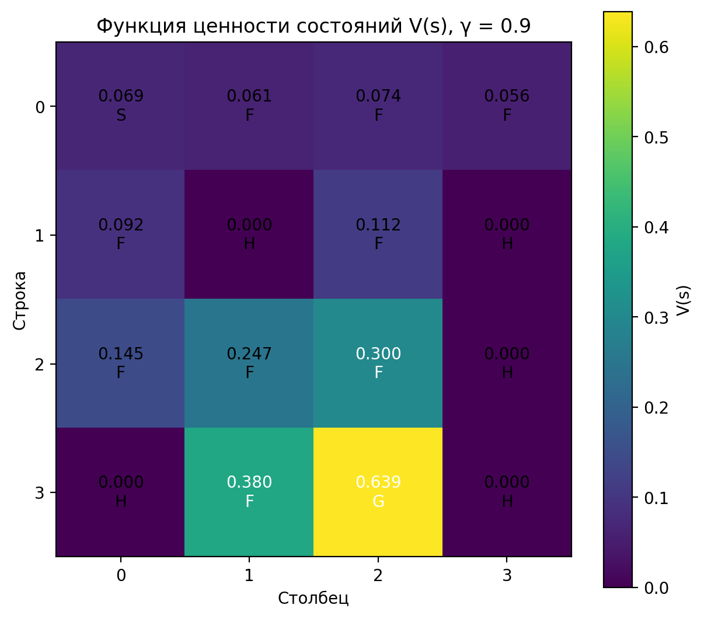
#### Рисунок 1 - функция ценности состояний

### Полученная стратегия

Обозначения действий: `←` — влево, `↓` — вниз, `→` — вправо, `↑` — вверх, `·` — терминальное состояние.

```text
←  ↑  ←  ↑
←  ·  ←  ·
↑  ↓  ←  ·
·  →  ↓  ·
```

Оба алгоритма получили одинаковую стратегию. В среде с вероятностными переходами выбор оптимального действия не гарантирует, что агент фактически переместится в ожидаемом направлении. Поэтому даже оптимальная стратегия не обеспечивает успешное завершение каждого эпизода.

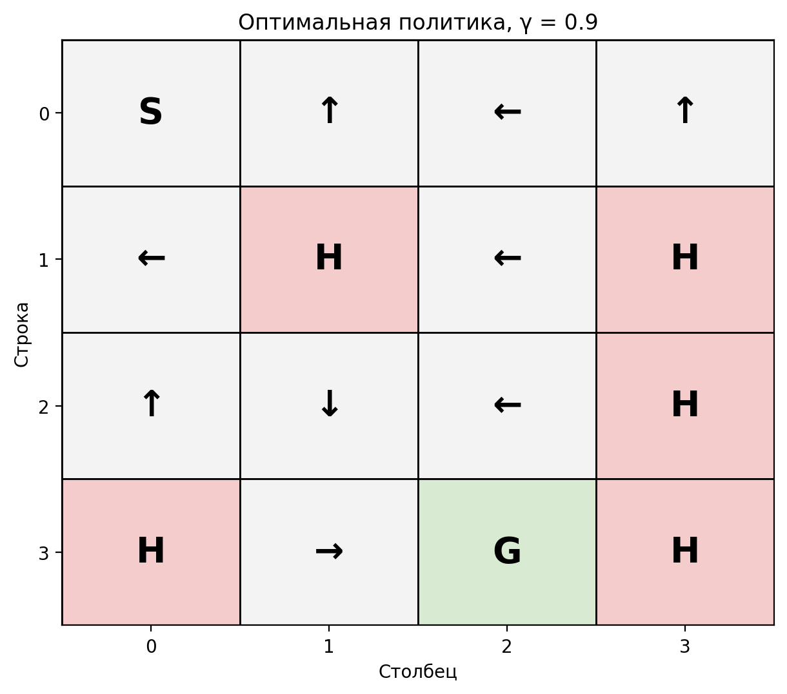
#### Рисунок 2 - оптимальная стратегия со стрелками

## Исследование влияния параметров алгоритмов

###  Влияние коэффициента дисконтирования $\gamma$

Коэффициент дисконтирования определяет, насколько сильно при расчёте ценности учитываются будущие вознаграждения. При значениях, близких к единице, отдалённые вознаграждения оказывают большее влияние на оценки состояний. Это может увеличивать вычислительные затраты, необходимые для достижения заданного порога сходимости.

В эксперименте исследовались значения $\gamma \in \{0.5, 0.7, 0.9, 0.99\}$. Порог сходимости был равен $\theta=10^{-6}$, а оценка каждой стратегии выполнялась на 500 эпизодах.

| Алгоритм | $\gamma$ | Итерации / улучшения стратегии | Проходы оценки | Время, с | Успешность | Среднее число шагов |
|---|---:|---:|---:|---:|---:|---:|
| `Value Iteration` | 0,50 | 16 | — | 0,014897 | 46,4% | 27,960 |
| `Value Iteration` | 0,70 | 27 | — | 0,002057 | 43,6% | 27,992 |
| `Value Iteration` | 0,90 | 78 | — | 0,006670 | 70,4% | 41,732 |
| `Value Iteration` | 0,99 | 305 | — | 0,025803 | 71,2% | 45,206 |
| `Policy Iteration` | 0,50 | 5 | 42 | 0,001665 | 43,6% | 27,992 |
| `Policy Iteration` | 0,70 | 5 | 73 | 0,003771 | 46,4% | 27,960 |
| `Policy Iteration` | 0,90 | 6 | 226 | 0,007063 | 70,4% | 41,732 |
| `Policy Iteration` | 0,99 | 7 | 809 | 0,022700 | 71,2% | 45,206 |

При увеличении $\gamma$ с 0,5 до 0,99 число итераций `Value Iteration` увеличилось с 16 до 305. Для `Policy Iteration` число проходов оценки стратегии выросло с 42 до 809, тогда как количество итераций улучшения стратегии изменилось с 5 до 7.  
Это показывает, что количество итераций улучшения стратегии не отражает всех вычислительных затрат `Policy Iteration`. Для анализа его работы необходимо учитывать и количество проходов оценки.

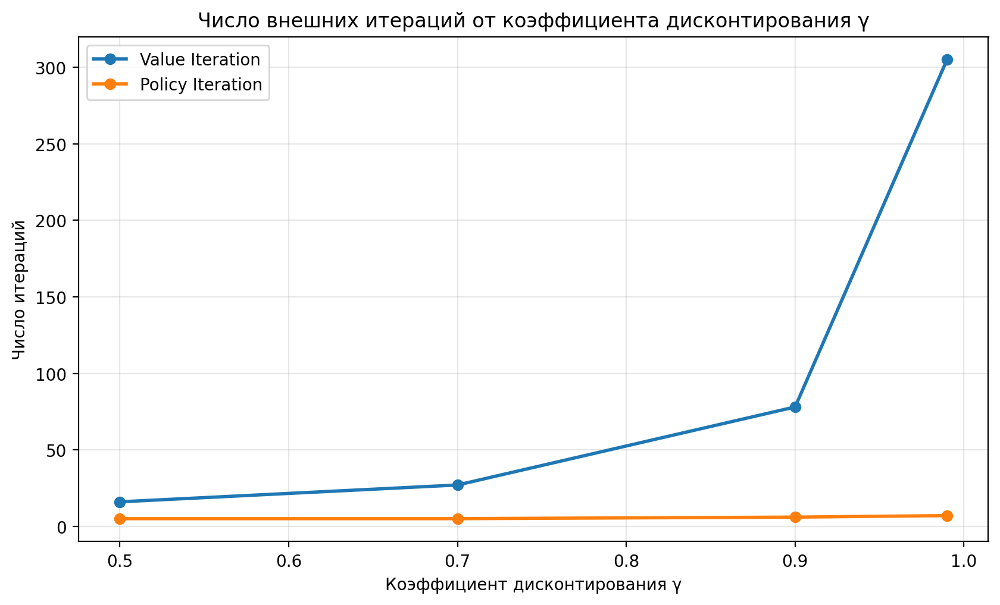
#### Рисунок 3 - Зависимость количества итераций от значения $\gamma$ 

При $\gamma=0.9$ оба алгоритма показали успешность 70,4%, а при $\gamma=0.99$ — 71,2%. Для $\gamma=0.5$ и $\gamma=0.7$ показатели двух алгоритмов различались на 2,8 процентного пункта. Такие различия могут быть связаны с выбором действий при равных или близких оценках ценности, а также со случайностью переходов во время оценки стратегий. 
По представленным данным нельзя утверждать, что успешность строго возрастает при каждом увеличении $\gamma$. При этом наблюдается увеличение количества итераций и проходов оценки при приближении коэффициента к единице.

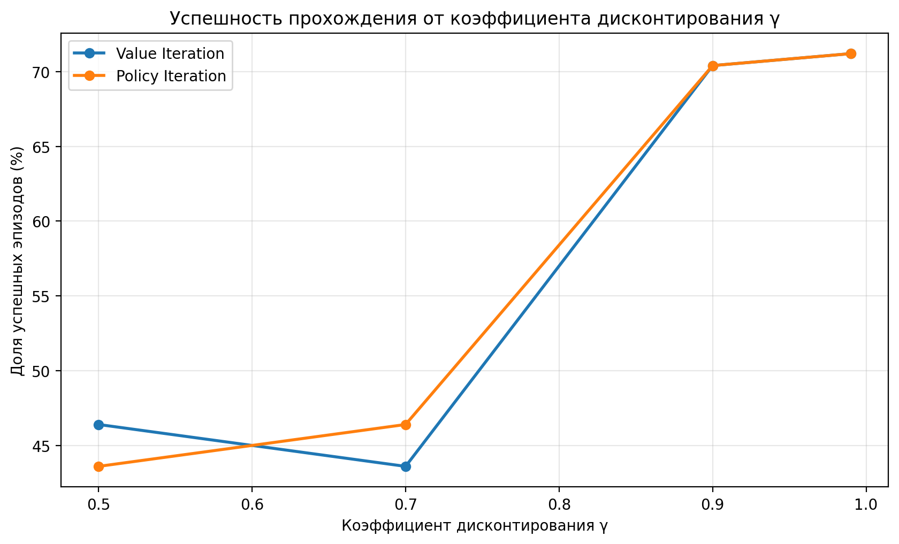
#### Рисунок 4 - Зависимость успешности прохождения от значения $\gamma$

При увеличении коэффициента дисконтирования наблюдается общий рост времени выполнения обоих алгоритмов. Для `Value Iteration` время увеличивается с 0,0149 с при $\gamma=0{,}5$ до 0,0258 с при $\gamma=0{,}99$. Аналогичная тенденция наблюдается для `Policy Iteration`: время выполнения возрастает с 0,0017 с до 0,0227 с.
Данная зависимость согласуется с результатами исследования сходимости алгоритмов. При увеличении $\gamma$ возрастает влияние будущих вознаграждений на оценку текущего состояния, что в исследуемой конфигурации сопровождается увеличением количества итераций до достижения заданного критерия остановки. Например, число итераций `Value Iteration` увеличивается с 16 до 305, а количество внешних итераций `Policy Iteration` — с 5 до 7. При этом для `Policy Iteration` также существенно увеличивается число проходов оценки политики: с 42 до 809.


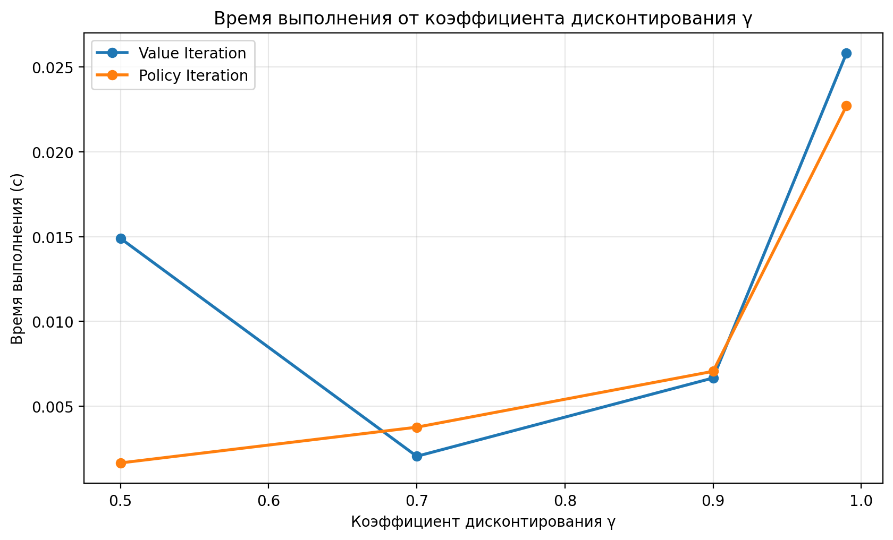
#### Рисунок 5 - Зависимость времени выполнения от значения $\gamma$ 


### Влияние порога сходимости $\theta$

Порог сходимости определяет допустимое изменение функции ценности между последовательными итерациями. Чем меньше значение $\theta$, тем более точного приближения требуется достичь, что обычно увеличивает количество вычислений.

Исследовались значения $\theta \in \{10^{-2},10^{-4},10^{-6},10^{-8}\}$ при $\gamma=0.9$. Оценка стратегий проводилась на 500 эпизодах.

| Алгоритм | $\theta$ | Итерации / улучшения стратегии | Проходы оценки | Время, с | Успешность | Среднее число шагов |
|---|---:|---:|---:|---:|---:|---:|
| `Value Iteration` | $10^{-2}$ | 10 | — | 0,002766 | 46,4% | 27,960 |
| `Value Iteration` | $10^{-4}$ | 44 | — | 0,003970 | 70,4% | 41,732 |
| `Value Iteration` | $10^{-6}$ | 78 | — | 0,006311 | 70,4% | 41,732 |
| `Value Iteration` | $10^{-8}$ | 112 | — | 0,009761 | 70,4% | 41,732 |
| `Policy Iteration` | $10^{-2}$ | 5 | 18 | 0,001002 | 46,4% | 27,960 |
| `Policy Iteration` | $10^{-4}$ | 6 | 106 | 0,003926 | 70,4% | 41,732 |
| `Policy Iteration` | $10^{-6}$ | 6 | 226 | 0,006320 | 70,4% | 41,732 |
| `Policy Iteration` | $10^{-8}$ | 6 | 344 | 0,009474 | 70,4% | 41,732 |

При уменьшении порога сходимости с $10^{-2}$ до $10^{-8}$ количество итераций `Value Iteration` увеличилось с 10 до 112. Для `Policy Iteration` количество проходов оценки стратегии выросло с 18 до 344, а количество улучшений стратегии изменилось с 5 до 6.

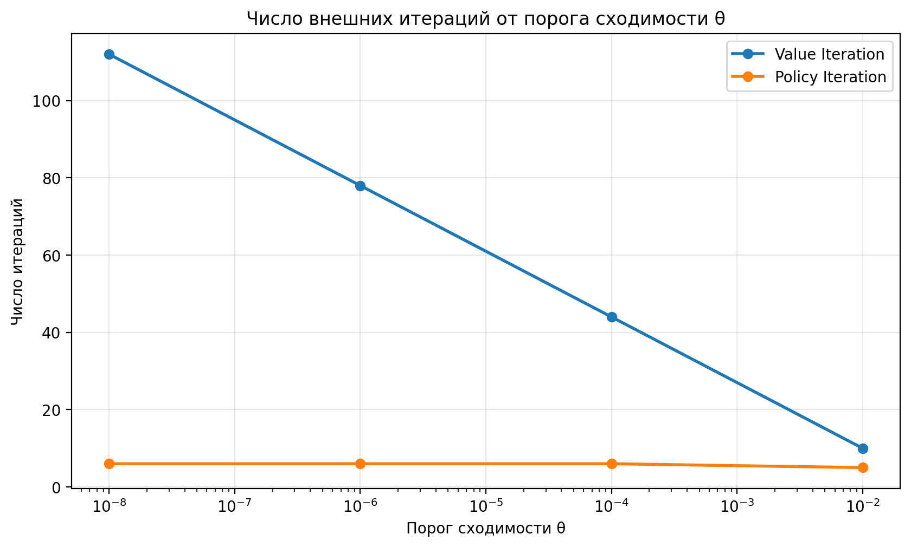
#### Рисунок 6 - Зависимость количества итераций от значения $\theta$ 

При $\theta=10^{-2}$ успешность составила 46,4% для обоих алгоритмов. При значениях $10^{-4}$, $10^{-6}$ и $10^{-8}$ она составила 70,4%. Таким образом, в данном эксперименте более строгий критерий сходимости увеличивал вычислительные затраты, но после достижения определённого уровня точности не изменял наблюдаемое качество стратегии. (Графики наложились друг на друга)

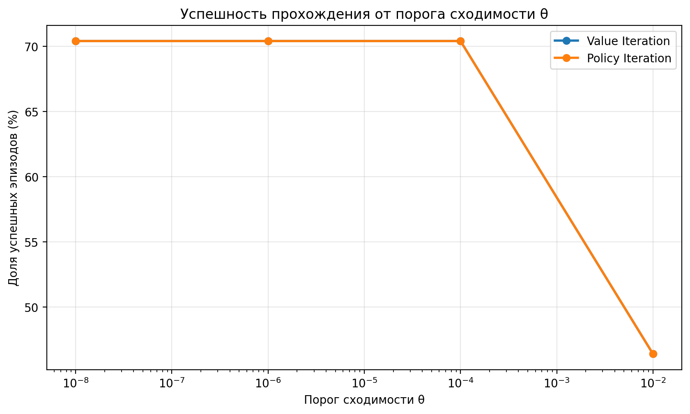
#### Рисунок 7 - Зависимость успешности прохождения от значения $\theta$ 

Важно учитывать, что значения времени в таблицах параметрического исследования получены в отдельных измерениях. Например, для $\gamma=0.9$ и $\theta=10^{-6}$ время `Value Iteration` составило 0,006670 с в исследовании $\gamma$ и 0,006311 с в исследовании $\theta$. Это небольшое расхождение объясняется тем, что измерения проводились в разных запусках.

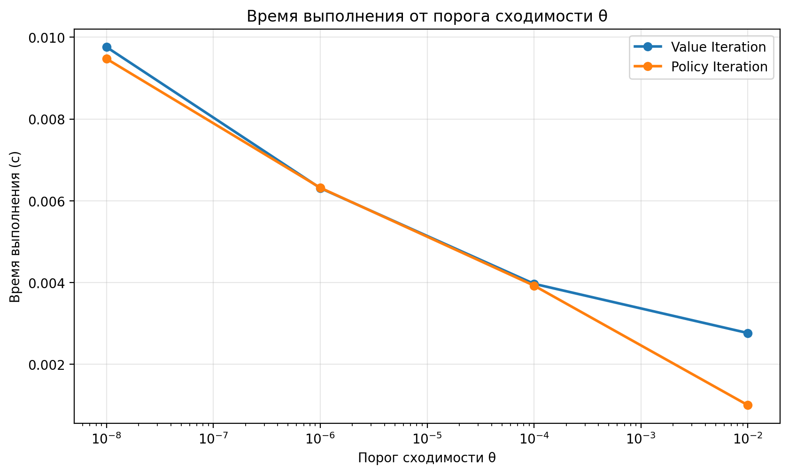
#### Рисунок 8 - Зависимость времени выполнения от значения $\theta$ 

## Исследование влияния характеристик окружающей среды

Для исследования среды рассматривались карты 4×4 и 8×8 с вероятностными и детерминированными переходами. Для всех конфигураций использовались $\gamma=0.9$, $\theta=10^{-6}$, а полученные стратегии оценивались на 1000 эпизодах.

### Результаты эксперимента

| Карта | `is_slippery` | Алгоритм | Число состояний | Итерации / улучшения стратегии | Проходы оценки | Время, с | Успешность | Среднее число шагов |
|---|---|---|---:|---:|---:|---:|---:|---:|
| 4×4 | `True` | `Value Iteration` | 16 | 78 | — | 0,007070 | 72,0% | 40,666 |
| 4×4 | `True` | `Policy Iteration` | 16 | 6 | 226 | 0,005611 | 72,0% | 40,666 |
| 4×4 | `False` | `Value Iteration` | 16 | 7 | — | 0,000402 | 100,0% | 6,000 |
| 4×4 | `False` | `Policy Iteration` | 16 | 7 | 14 | 0,000779 | 100,0% | 6,000 |
| 8×8 | `True` | `Value Iteration` | 64 | 86 | — | 0,026524 | 58,9% | 65,997 |
| 8×8 | `True` | `Policy Iteration` | 64 | 10 | 359 | 0,036468 | 58,9% | 65,997 |
| 8×8 | `False` | `Value Iteration` | 64 | 15 | — | 0,002995 | 100,0% | 14,000 |
| 8×8 | `False` | `Policy Iteration` | 64 | 15 | 29 | 0,006828 | 100,0% | 14,000 |

### Влияние размера карты

При переходе от карты 4×4 к карте 8×8 количество состояний увеличилось с 16 до 64.

В детерминированной среде `Value Iteration` выполнил 7 итераций на карте 4×4 и 15 итераций на карте 8×8. `Policy Iteration` потребовал соответственно 7 и 15 итераций улучшения стратегии, при этом количество проходов оценки составило 14 и 29.

В вероятностной среде `Value Iteration` выполнил 78 итераций на карте 4×4 и 86 на карте 8×8. `Policy Iteration` потребовал соответственно 6 и 10 итераций улучшения стратегии и 226 и 359 проходов оценки.

Увеличение карты сопровождалось снижением успешности с 72,0% до 58,9% в вероятностной среде и увеличением среднего числа шагов с 40,666 до 65,997. Это согласуется с тем, что большая карта содержит больше состояний и предполагает более длинный маршрут, а вероятностные отклонения усложняют достижение цели.

### Влияние вероятностных переходов

При `is_slippery=False` оба алгоритма достигли успешности 100% на обеих картах в выборке из 1000 эпизодов. Среднее число шагов составило 6 для карты 4×4 и 14 для карты 8×8.

При `is_slippery=True` успешность составила 72,0% на карте 4×4 и 58,9% на карте 8×8. При вероятностных переходах фактическое перемещение может не совпасть с выбранным направлением, поэтому агент может отклониться от маршрута или попасть в провал.

Следовательно, в проведённых экспериментах случайность переходов существенно снижала успешность выполнения задачи. Значение 100% для детерминированной среды относится к проверенным 1000 эпизодам и не является самостоятельным доказательством для произвольных конфигураций среды.

### Сравнение алгоритмов в разных конфигурациях среды

В каждой из четырёх конфигураций `Value Iteration` и `Policy Iteration` показали одинаковые значения успешности и среднего количества шагов. Это согласуется с тем, что алгоритмы получили эквивалентные по результатам стратегии в этих экспериментах.

При этом вычислительные затраты различались. Например, для карты 8×8 с вероятностными переходами `Value Iteration` выполнил 86 итераций за 0,026524 с. `Policy Iteration` выполнил 10 улучшений стратегии и 359 проходов оценки за 0,036468 с. В этой конфигурации `Policy Iteration` оказался медленнее, несмотря на меньшее число итераций улучшения.

Для карты 4×4 с вероятностными переходами в отдельном эксперименте время составило 0,007070 с для `Value Iteration` и 0,005611 с для `Policy Iteration`. Эти значения отличаются от времени в таблице базового сравнения в пункте 5, поскольку измерения проводились в разных запусках. Для кратковременных вычислений такие расхождения возможны; поэтому сравнивать время следует осторожно и, при необходимости, по нескольким повторным запускам с усреднением.

Количество итераций улучшения стратегии нельзя напрямую сравнивать с количеством итераций `Value Iteration`. Для `Policy Iteration` необходимо учитывать число проходов оценки стратегии и фактическое время выполнения.

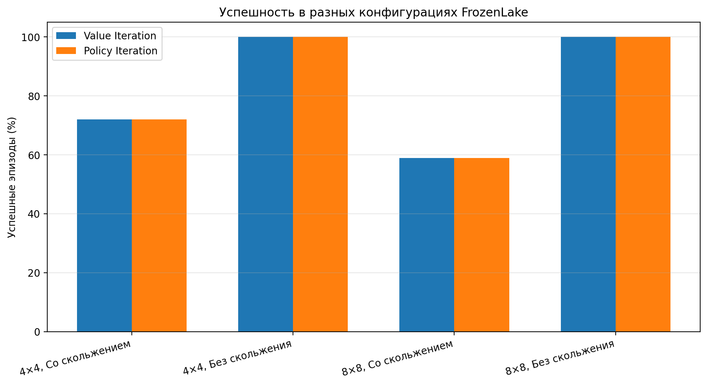
#### Рисунок 9 - Отражение успешности в разных конфигурациях среды 

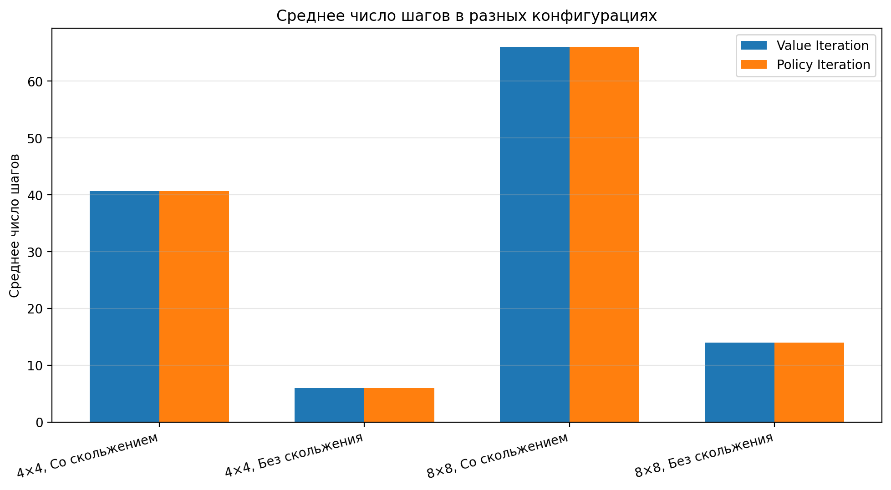
#### Рисунок 10 - Отражение среднего числа шагов в разных конфигурациях среды

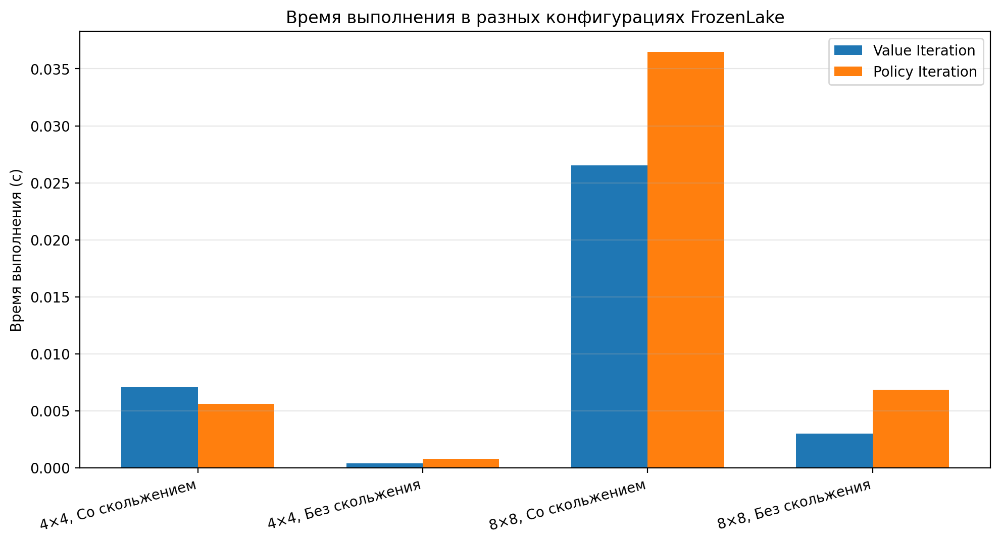
#### Рисунок 11 - Отражение времени выполнения в разных конфигурациях среды


## Ограничения эксперимента

1. Успешность оценивалась на конечной выборке. Значение 100% означает, что все 1000 проверенных эпизодов завершились успешно, но не доказывает успех во всех возможных запусках.
2. Время выполнения зависит от оборудования, фоновой нагрузки, версий библиотек и особенностей измерения. Приведённые значения относятся к конкретным запускам.
3. Для исследования $\gamma$ и $\theta$ использовалось 500 эпизодов оценки, а для исследования конфигураций среды — 1000. Поэтому проценты успешности из разных серий не следует напрямую сравнивать как результаты одной и той же выборки.
4. В вероятностной среде результаты зависят от случайных переходов.
5. Число итераций `Value Iteration` и число улучшений стратегии `Policy Iteration` — разные метрики. Для `Policy Iteration` дополнительно учитывались проходы оценки стратегии.
6. Для более строгого сравнения времени выполнения желательно провести несколько повторных запусков каждой конфигурации и сравнить средние значения.

## Заключение

В работе исследована задача принятия решений на марковском процессе на примере среды FrozenLake. Были рассмотрены и сравнены алгоритмы `Value Iteration` и `Policy Iteration`. Проведены эксперименты по влиянию коэффициента дисконтирования, порога сходимости, размера карты и вероятностного характера переходов.

В базовом эксперименте на карте 4×4 с вероятностными переходами оба алгоритма получили одинаковую стратегию и показали успешность 72,0% при среднем количестве шагов 40,67. `Value Iteration` выполнил 78 итераций, а `Policy Iteration` — 6 итераций улучшения стратегии и 226 проходов оценки. В конкретном базовом запуске время выполнения составило 0,019517 с и 0,006113 с соответственно.

Исследование коэффициента дисконтирования показало, что при увеличении \(\gamma\) с 0,5 до 0,99 число итераций `Value Iteration` выросло с 16 до 305, а число проходов оценки `Policy Iteration` — с 42 до 809. При этом успешность не изменялась строго монотонно для всех промежуточных значений.

Исследование порога сходимости показало, что уменьшение \(\theta\) с \(10^{-2}\) до \(10^{-8}\) увеличило число итераций `Value Iteration` с 10 до 112, а число проходов оценки `Policy Iteration` — с 18 до 344. При \(\theta \leq 10^{-4}\) успешность в данной серии оставалась равной 70,4%.

Исследование окружающей среды показало, что в детерминированных конфигурациях успешность составила 100% в выборке из 1000 эпизодов. При вероятностных переходах успешность составила 72,0% на карте 4×4 и 58,9% на карте 8×8. Увеличение карты и случайность переходов сопровождались ростом среднего числа шагов и снижением успешности.
