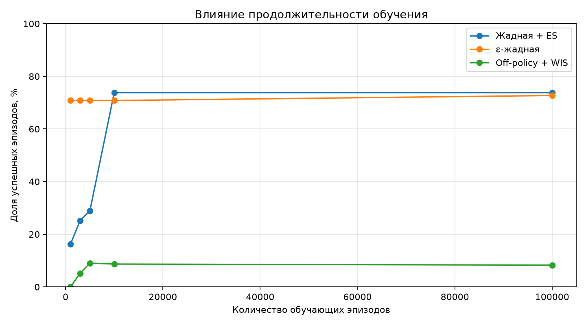

# Лабораторная работа № 3. Исследование метода Монте-Карло

## Цель работы

Исследовать методы получения стратегии управления на основе метода
Монте-Карло в среде FrozenLake, реализовать жадный, ε-жадный и
off-policy подходы и сравнить их экспериментальные характеристики.

Для достижения поставленной цели необходимо решить следующие задачи:

1. Изучить основные принципы метода Монте-Карло в обучении с подкреплением.
2. Рассмотреть особенности среды FrozenLake и определить параметры экспериментальной среды.
3. Реализовать алгоритм оценки ценности состояний и пар «состояние — действие» методом Монте-Карло.
4. Реализовать алгоритм управления с жадной стратегией и механизмом Exploring Starts.
5. Реализовать алгоритм управления с ε-жадной стратегией.
6. Реализовать внеполитический алгоритм управления с использованием Weighted Importance Sampling.
7. Провести экспериментальное сравнение реализованных алгоритмов по доле успешных эпизодов и средней продолжительности эпизода.
8. Исследовать влияние количества обучающих эпизодов и параметра ε на результаты обучения.
9. Проанализировать полученные результаты и определить особенности применения рассмотренных алгоритмов.


# Введение

В задачах обучения с подкреплением важную роль играют методы, позволяющие оценивать качество принимаемых решений на основе взаимодействия агента с окружающей средой. Одним из таких подходов является метод Монте-Карло, основанный на обработке полных эпизодов взаимодействия и вычислении фактически полученного вознаграждения.

Методы Монте-Карло позволяют оценивать ценность состояний и действий без необходимости построения модели окружающей среды. На их основе могут быть реализованы алгоритмы управления, направленные на последовательное улучшение стратегии агента. При этом результат обучения зависит от выбранного способа формирования эпизодов, организации исследования пространства действий и количества накопленных наблюдений.

В данной лабораторной работе рассматриваются различные подходы к управлению на основе метода Монте-Карло: управление с жадной стратегией и механизмом Exploring Starts, управление с ε-жадной стратегией, а также внеполитическое управление с использованием взвешенной выборки по важности (Weighted Importance Sampling).

В качестве тестовой среды используется FrozenLake — дискретная среда обучения с подкреплением, в которой агент должен достичь целевой клетки, избегая попадания в опасные клетки. Наличие вероятностного перехода между состояниями позволяет исследовать поведение алгоритмов в условиях неопределённости.

# Постановка задачи и описание среды

## Описание среды FrozenLake

FrozenLake представляет собой дискретную среду обучения с подкреплением, в которой агент перемещается по игровому полю от начальной позиции к целевой клетке. Перемещение осуществляется по четырём направлениям: влево, вниз, вправо и вверх.

Игровое поле содержит следующие типы клеток:

- начальная позиция (Start) — положение агента в начале эпизода;
- безопасная клетка (Frozen) — клетка, по которой агент может перемещаться;
- опасная клетка (Hole) — попадание в неё приводит к завершению эпизода без получения награды;
- целевая клетка (Goal) — достижение данной клетки приводит к успешному завершению эпизода и получению награды.

В работе используется карта размером 4 × 4:

```text
S F F F
F H F H
F F F H
H F F G
```

где `S` — начальная позиция, `F` — безопасная клетка, `H` — опасная клетка, `G` — целевая клетка.

Для проведения экспериментов используется скользящий режим среды (`is_slippery=True`). В этом режиме фактическое направление перемещения может отличаться от выбранного агентом. Таким образом, даже при выборе одного и того же действия переход из состояния может приводить к различным результатам.

## Формализация задачи

Среда FrozenLake рассматривается как марковский процесс принятия решений (Markov Decision Process, MDP), определяемый множеством состояний $S$, множеством действий $A$, функцией переходов $P$, функцией вознаграждения $R$ и коэффициентом дисконтирования $\gamma$.

Состояние среды соответствует текущему положению агента на игровом поле. Всего на карте 4 × 4 имеется 16 возможных состояний, соответствующих отдельным клеткам.

Множество действий включает четыре варианта перемещения:

| Действие | Обозначение | Код |
|---|---|---:|
| Влево | LEFT | 0 |
| Вниз | DOWN | 1 |
| Вправо | RIGHT | 2 |
| Вверх | UP | 3 |

Вознаграждение начисляется только при достижении целевой клетки. За успешное завершение эпизода агент получает 1, в остальных случаях — 0.

В экспериментах используются следующие параметры:

| Параметр | Значение |
|---|---:|
| Среда | FrozenLake-v1 |
| Размер карты | 4 × 4 |
| Скользящий режим | Включён |
| Коэффициент дисконтирования $\gamma$ | 1.0 |
| Максимальная длина эпизода | 100 шагов |
| Количество обучающих эпизодов в основном эксперименте | 100 000 |
| Количество эпизодов оценки | 100 000 |
| Начальное состояние | 0 |
| Целевое состояние | 15 |

## Критерии оценки качества стратегии

Для сравнения алгоритмов используются два основных показателя.

**Доля успешных эпизодов (Success Rate)** — отношение количества эпизодов, завершившихся достижением целевой клетки, к общему количеству оценочных эпизодов:

$$
SuccessRate = \frac{N_{success}}{N_{total}}\cdot 100\%.
$$

Данный показатель позволяет оценить, насколько часто обученная стратегия приводит агента к достижению цели.

**Средняя продолжительность эпизода (Average Steps)** — среднее количество шагов, выполненных агентом до завершения эпизода:

$$
AverageSteps = \frac{1}{N}\sum_{i=1}^{N}T_i,
$$

где $T_i$ — количество шагов в $i$-м эпизоде, а $N$ — общее количество оценочных эпизодов.

При интерпретации второго показателя необходимо учитывать, что эпизод может завершиться не только достижением цели, но и попаданием в опасную клетку. Поэтому меньшее среднее количество шагов само по себе не свидетельствует о более эффективной стратегии.

Для повышения объективности основное сравнение проводится с использованием нескольких случайных начальных зерён (seed). В качестве итоговых характеристик рассчитываются среднее значение и стандартное отклонение показателей по результатам трёх запусков.

# Теоретические основы метода Монте-Карло

## Общие принципы метода Монте-Карло

Методы Монте-Карло (Monte Carlo, MC) представляют собой класс алгоритмов обучения с подкреплением, использующих результаты взаимодействия агента со средой для оценки качества состояний и принимаемых действий.

Основная идея метода заключается в том, что оценка ценности состояния или действия выполняется на основе фактически полученного вознаграждения за завершённый эпизод. В отличие от методов временных разностей (Temporal Difference, TD), методы Монте-Карло не используют оценку следующего состояния для непосредственного обновления текущей оценки. Вместо этого они ожидают завершения эпизода и используют накопленный за него возврат.

Взаимодействие агента со средой представляет собой последовательность:

$$
S_0,A_0,R_1,S_1,A_1,R_2,\ldots,S_T,
$$

где:

- $S_t$ — состояние среды на шаге $t$;
- $A_t$ — действие агента;
- $R_{t+1}$ — вознаграждение, полученное после выполнения действия;
- $T$ — момент завершения эпизода.

Для оценки качества поведения агента используется величина возврата (Return) — суммарное дисконтированное вознаграждение, полученное начиная с определённого шага:

$$
G_t = \sum_{k=t+1}^{T}\gamma^{k-t-1}R_k,
$$

где $\gamma$ — коэффициент дисконтирования, принимающий значения от 0 до 1.

При $\gamma=0$ учитывается только ближайшее вознаграждение, тогда как при значениях, близких к 1, учитываются и более отдалённые результаты действий. В данной работе используется $\gamma=1.0$, поэтому возврат представляет собой сумму всех вознаграждений, полученных до завершения эпизода.

Вычисление возврата может выполняться рекурсивно:

$$
G_t=R_{t+1}+\gamma G_{t+1},
$$

при начальном значении $G_T=0$.

Таким образом, метод Монте-Карло позволяет оценивать качество поведения агента на основе завершённых последовательностей взаимодействия со средой.

## Оценка ценности состояний: First-Visit и Every-Visit

Одной из основных задач обучения с подкреплением является оценка функции ценности состояния $V(s)$, которая определяет ожидаемый возврат при нахождении агента в состоянии $s$ и дальнейшем следовании выбранной стратегии $\pi$:

$$
V^\pi(s)=\mathbb{E}_\pi[G_t\mid S_t=s].
$$

Для приближённого вычисления функции ценности используется усреднение фактически полученных возвратов по эпизодам.

Метод Монте-Карло предусматривает два распространённых варианта такого усреднения: First-Visit и Every-Visit.

**First-Visit Monte Carlo** учитывает только первое посещение конкретного состояния в пределах одного эпизода. Если агент несколько раз оказывается в одном состоянии, в расчёт включается только возврат, соответствующий первому посещению.

Оценка функции ценности определяется следующим образом:

$$
V(s)=\frac{1}{N(s)}
\sum_{i=1}^{N(s)}G_i(s),
$$

где $N(s)$ — количество эпизодов, в которых состояние $s$ было посещено, а $G_i(s)$ — возврат после первого посещения этого состояния в $i$-м эпизоде.

**Every-Visit Monte Carlo** учитывает все посещения состояния, включая повторные в рамках одного эпизода. В этом случае каждое посещение рассматривается как отдельное наблюдение.

Оба подхода позволяют оценивать функцию ценности, однако отличаются способом формирования выборки наблюдений. First-Visit исключает повторные посещения одного состояния внутри эпизода, тогда как Every-Visit использует все доступные наблюдения.

В рамках лабораторной работы рассматриваются оба варианта оценки ценности состояний, что позволяет изучить особенности обработки эпизодов и накопления статистики.

## Оценка ценности пар «состояние — действие»

Для решения задачи управления недостаточно знать только ценность состояний. Агенту необходимо определять, какое действие предпочтительнее выполнить в каждом состоянии.

Для этого используется функция ценности действия $Q(s,a)$, которая представляет собой ожидаемый возврат при выборе действия $a$ в состоянии $s$ с последующим следованием стратегии $\pi$:

$$
Q^\pi(s,a)=\mathbb{E}_\pi[G_t\mid S_t=s,A_t=a].
$$

Оценка функции $Q(s,a)$ методом Монте-Карло выполняется аналогично оценке $V(s)$, но статистика накапливается отдельно для каждой пары «состояние — действие».

Для каждой наблюдаемой пары сохраняется количество посещений $N(s,a)$ и сумма полученных возвратов. Итоговая оценка определяется выражением:

$$
Q(s,a)=\frac{1}{N(s,a)}
\sum_{i=1}^{N(s,a)}G_i(s,a).
$$

На основе полученных значений можно выбирать действие с наибольшей оценкой:

$$
\pi(s)=\arg\max_{a\in A}Q(s,a).
$$

Таким образом, функция $Q(s,a)$ служит основой для построения стратегии управления, позволяя сравнивать возможные действия в каждом состоянии.

## Метод Монте-Карло для управления

В отличие от задачи оценки, где стратегия агента заранее задана, задача управления предполагает последовательное улучшение стратегии с целью увеличения ожидаемого вознаграждения.

Общий принцип MC Control заключается в чередовании двух этапов:

1. **Оценка стратегии.** Агент взаимодействует со средой, получает эпизоды и обновляет значения $Q(s,a)$ на основе фактически полученных возвратов.
2. **Улучшение стратегии.** На основании обновлённых значений $Q(s,a)$ корректируется выбор действий агента.

Данный процесс повторяется на протяжении обучения. По мере накопления опыта оценки действий уточняются, что позволяет агенту постепенно формировать более эффективную стратегию.

Одной из основных проблем управления является необходимость исследования среды (Exploration) и использования уже полученных знаний (Exploitation).

Исследование предполагает выбор различных действий для получения информации об их последствиях. Использование знаний заключается в выборе действий, которые согласно текущим оценкам обеспечивают наибольший ожидаемый возврат.

Если агент будет постоянно выбирать только лучшее на текущий момент действие, он может не обнаружить более эффективные альтернативы. С другой стороны, чрезмерное исследование снижает долю действий, направленных на получение максимального вознаграждения.

Для решения этой проблемы применяются различные стратегии выбора действий, на которых основаны рассматриваемые далее алгоритмы управления.

## Жадное управление с механизмом Exploring Starts

Жадная стратегия (Greedy Policy) предполагает выбор действия с максимальным текущим значением функции $Q(s,a)$:

$$
\pi(s)=\arg\max_{a\in A}Q(s,a).
$$

Данный подход позволяет использовать накопленные знания, однако обладает существенным недостатком: если некоторые действия недостаточно исследованы, агент может преждевременно остановиться на неоптимальной стратегии.

Одним из способов решения данной проблемы является механизм Exploring Starts (ES). Его идея заключается в обеспечении возможности начать эпизод с различных пар «состояние — действие».

В начале каждого эпизода случайным образом выбирается начальное состояние и действие, после чего агент продолжает взаимодействие со средой, используя текущую жадную стратегию.

За счёт этого обеспечивается исследование различных областей пространства состояний и действий, даже если дальнейшее поведение агента является жадным.

В рамках алгоритма после завершения эпизода выполняется First-Visit обновление значений $Q(s,a)$. Затем стратегия корректируется на основе обновлённых оценок.

Следует учитывать, что стандартная среда FrozenLake начинает каждый эпизод с фиксированного начального состояния. Поэтому для реализации Exploring Starts в лабораторной работе начальное состояние среды и первое действие задаются программно. Это позволяет моделировать выбор различных начальных пар «состояние — действие» в рамках эксперимента.

## Управление с использованием ε-жадной стратегии

ε-жадная стратегия (ε-Greedy Policy) является способом балансировки исследования и использования накопленных знаний.

В отличие от полностью жадной стратегии, ε-жадный алгоритм с вероятностью $\varepsilon$ выбирает случайное действие, а с вероятностью $1-\varepsilon$ — одно из действий с максимальным значением $Q(s,a)$.

Вероятность выбора действия можно представить следующим образом. Для уникального жадного действия в среде с четырьмя возможными действиями:

$$
\pi(a\mid s)=
\begin{cases}
1-\varepsilon+\frac{\varepsilon}{4},
& a=\arg\max_{a'}Q(s,a'),\\
\frac{\varepsilon}{4},
& \text{в остальных случаях}.
\end{cases}
$$

При наличии нескольких действий с одинаковым максимальным значением выбор между ними осуществляется равномерно.

Параметр $\varepsilon$ определяет интенсивность исследования:

- при $\varepsilon=0$ стратегия становится полностью жадной;
- при увеличении $\varepsilon$ возрастает вероятность выбора случайных действий;
- при $\varepsilon=1$ действия выбираются равномерно независимо от оценок $Q(s,a)$.

В процессе обучения значения $Q(s,a)$ обновляются по завершённым эпизодам, после чего ε-жадная стратегия использует новые оценки для выбора действий.

В лабораторной работе данный алгоритм исследуется при различных значениях $\varepsilon$, что позволяет оценить влияние интенсивности исследования на качество итоговой стратегии.

## Внеполитическое управление с использованием Weighted Importance Sampling

Внеполитические методы (Off-policy Methods) позволяют обучать одну стратегию на основе данных, полученных при следовании другой стратегии.

В таком подходе выделяются две политики:

- **Поведенческая стратегия (Behavior Policy)** — стратегия, с помощью которой агент взаимодействует со средой и собирает эпизоды.
- **Целевая стратегия (Target Policy)** — стратегия, качество которой требуется оценить и улучшить.

В рассматриваемой реализации поведенческая стратегия выбирает действия равномерно случайным образом:

$$
b(a\mid s)=\frac{1}{|A|}.
$$

При четырёх возможных действиях вероятность выбора каждого из них составляет $0.25$.

Целевая стратегия является жадной и выбирает действие с максимальным текущим значением функции $Q(s,a)$:

$$
\pi(s)=\arg\max_{a\in A}Q(s,a).
$$

Поскольку эпизоды собираются с использованием поведенческой стратегии, полученные возвраты нельзя непосредственно использовать для оценки целевой стратегии без дополнительной корректировки. Для этого применяется метод взвешивания по важности (Importance Sampling).

Коэффициент важности определяется отношением вероятностей выбора действий целевой и поведенческой стратегиями:

$$
\rho_{t:T-1}=
\prod_{k=t}^{T-1}
\frac{\pi(A_k\mid S_k)}
{b(A_k\mid S_k)}.
$$

Данный коэффициент позволяет скорректировать вклад наблюдаемого эпизода с учётом различий между двумя стратегиями.

В алгоритме используется вариант взвешенного взвешивания по важности (Weighted Importance Sampling, WIS). Для каждой пары «состояние — действие» поддерживается накопленный вес $C(s,a)$, который используется при обновлении оценки $Q(s,a)$.

Обновление накопленного веса выполняется по формуле:

$$
C(s,a)\leftarrow C(s,a)+W,
$$

а оценка ценности действия обновляется следующим образом:

$$
Q(s,a)\leftarrow Q(s,a)+
\frac{W}{C(s,a)}
\left(G-Q(s,a)\right),
$$

где $W$ — текущий вес наблюдения, а $G$ — возврат, рассчитанный для соответствующего шага эпизода.

Обработка эпизода выполняется в обратном порядке — от последнего действия к первому. После обновления оценки целевая стратегия улучшается на основании новых значений $Q(s,a)$.

Для детерминированной целевой стратегии вероятность действия, не являющегося жадным, равна нулю. Поэтому при обратной обработке эпизода алгоритм прекращает обновление, если фактически выбранное действие не совпадает с действием целевой стратегии:

$$
A_t\neq\pi(S_t).
$$

Если действие совпадает с целевым, вес корректируется:

$$
W\leftarrow\frac{W}{b(A_t\mid S_t)}.
$$

Таким образом, Weighted Importance Sampling позволяет использовать эпизоды, полученные при одной стратегии, для обучения другой. Вместе с тем при значительном различии поведенческой и целевой стратегий веса могут обладать высокой дисперсией, что усложняет процесс обучения и может приводить к нестабильным оценкам.

## Сравнение рассматриваемых алгоритмов

Рассмотренные алгоритмы отличаются способом исследования среды и механизмом обновления целевой стратегии.

| Характеристика | Greedy + Exploring Starts | ε-Greedy | Off-policy + WIS |
|---|---|---|---|
| Тип управления | On-policy | On-policy | Off-policy |
| Выбор действий | Жадный | ε-жадный | Случайный для поведения |
| Исследование | Случайный старт пары «состояние — действие» | Случайный выбор с вероятностью ε | Равномерная поведенческая стратегия |
| Целевая стратегия | Жадная | ε-жадная во время обучения | Жадная |
| Обновление оценок | First-Visit MC | First-Visit MC | Weighted Importance Sampling |
| Основная особенность | Исследование за счёт начальных условий | Баланс исследования и использования | Разделение поведенческой и целевой стратегий |

Таким образом, в работе рассматриваются три подхода к управлению, позволяющие исследовать влияние механизма исследования среды и способа использования накопленного опыта на качество формируемой стратегии.

# Программная реализация алгоритмов

## Используемые инструменты

Для реализации лабораторной работы использован язык программирования Python. В качестве библиотеки для взаимодействия со средой обучения с подкреплением применяется Gymnasium, предоставляющая готовую реализацию FrozenLake.

Для обработки числовых данных и хранения оценок функций ценности используется библиотека NumPy. Дополнительно применяются стандартные средства Python для организации модулей, управления параметрами экспериментов и сохранения результатов.

## Создание и настройка среды

Для создания среды используется функция `gymnasium.make`, позволяющая выбрать необходимую конфигурацию FrozenLake.

В работе используется среда `FrozenLake-v1` с картой 4 × 4 и включённым скользящим режимом.

При выполнении каждого шага агент передаёт среде выбранное действие и получает новое состояние, вознаграждение, а также признаки завершения эпизода.

Для корректной обработки завершения взаимодействия учитываются два признака:

- `terminated` — эпизод завершён вследствие достижения терминального состояния;
- `truncated` — эпизод принудительно остановлен, например из-за ограничения максимального количества шагов.

Общее условие завершения эпизода определяется выражением:

$$
done = terminated \lor truncated.
$$

Для воспроизводимости экспериментов используется фиксированное начальное зерно генератора случайных чисел. Это позволяет повторять запуски с одинаковыми начальными условиями генерации случайных последовательностей.

Отдельно учитывается ограничение стандартной реализации FrozenLake: при обычном вызове `reset()` агент начинает движение из фиксированной начальной клетки. Для реализации Exploring Starts в соответствующем алгоритме начальное состояние задаётся программно.

## Реализация базовых операций метода Монте-Карло

Перед реализацией алгоритмов управления были разработаны общие функции, необходимые для генерации эпизодов и вычисления возвратов.

Основная операция — генерация эпизода взаимодействия агента со средой. На каждом шаге определяется действие в соответствии с переданной стратегией, после чего выполняется переход среды и сохраняется полученный результат.

В результате формируется последовательность переходов, содержащая:

$$
(S_t,A_t,R_{t+1}).
$$

Для каждого эпизода сохраняются состояния, выбранные действия и соответствующие вознаграждения. Полученная последовательность используется при последующем обновлении оценок.

Для вычисления возвратов применяется обратный проход по эпизоду. Начальное значение возврата принимается равным нулю, после чего на каждом шаге выполняется:

$$
G\leftarrow R_{t+1}+\gamma G.
$$

Таким образом, для каждого шага эпизода рассчитывается сумма вознаграждений, полученных после выбора соответствующего действия.

Также реализованы две процедуры оценки функции ценности состояний:

- First-Visit MC — учитывает первое посещение состояния в пределах эпизода;
- Every-Visit MC — учитывает все посещения состояния.

Для этого используются множества уже обработанных состояний и накопители статистики, позволяющие рассчитывать средние значения возвратов.

## Реализация Greedy Monte Carlo Control с Exploring Starts

Первый алгоритм управления основан на жадном выборе действий и механизме Exploring Starts.

Для хранения оценок используется двумерная таблица $Q(s,a)$, в которой строки соответствуют состояниям среды, а столбцы — возможным действиям.

В начале обучения значения таблицы инициализируются нулями.

Для каждого эпизода выполняются следующие операции:

1. Случайным образом выбирается допустимое начальное состояние.
2. Для выбранного состояния определяется случайное начальное действие.
3. Начальное состояние среды устанавливается программно.
4. Выполняется выбранное действие, после чего агент продолжает взаимодействие с использованием жадной стратегии.
5. После завершения эпизода вычисляются возвраты для всех шагов.
6. Выполняется First-Visit обновление значений $Q(s,a)$.
7. Стратегия корректируется на основании обновлённых оценок.

Обновление оценки пары «состояние — действие» осуществляется по формуле:

$$
Q(s,a)=\frac{1}{N(s,a)}
\sum_{i=1}^{N(s,a)}G_i(s,a).
$$

Для выбора действия используется максимальное значение в соответствующей строке таблицы:

$$
a^*=\arg\max_a Q(s,a).
$$

Если несколько действий имеют одинаковую максимальную оценку, одно из них выбирается случайным образом. Это позволяет избежать постоянного предпочтения действия с минимальным индексом.

Особенность реализации заключается в необходимости программного изменения начального состояния среды, поскольку стандартный механизм `reset()` не предусматривает произвольного выбора начальной клетки. В результате Exploring Starts реализуется посредством установки начального состояния и выполнения заранее выбранного действия.

## Реализация ε-Greedy Monte Carlo Control

Второй алгоритм использует ε-жадную стратегию для балансировки исследования и использования накопленных знаний.

В отличие от предыдущего алгоритма, начальное состояние каждого эпизода остаётся стандартным — агент начинает движение из клетки с индексом 0.

Выбор действия определяется текущим значением параметра $\varepsilon$:

- с вероятностью $1-\varepsilon$ выбирается одно из действий с максимальным значением $Q(s,a)$;
- с вероятностью $\varepsilon$ выбирается случайное действие из доступного множества.

В реализованном варианте случайное действие выбирается равномерно среди всех четырёх действий. Если имеется несколько действий с одинаковой максимальной оценкой, жадный выбор также выполняется случайным образом среди них.

После генерации эпизода вычисляются возвраты и выполняется First-Visit обновление таблицы $Q(s,a)$.

Таким образом, алгоритм последовательно уточняет оценки действий и использует их для формирования ε-жадной стратегии.

Для итоговой оценки качества обучения применяется уже жадная стратегия:

$$
\pi(s)=\arg\max_a Q(s,a).
$$

Это означает, что случайное исследование отключается на этапе оценки. Такой подход позволяет сравнить качество сформированной стратегии, не учитывая дополнительные случайные действия, используемые непосредственно во время обучения.

## Реализация Off-policy Monte Carlo Control с Weighted Importance Sampling

Третий алгоритм реализует внеполитическое управление с использованием взвешенной выборки по важности.

В отличие от двух предыдущих алгоритмов, здесь используются две отдельные стратегии:

- поведенческая стратегия — равномерно случайный выбор действий;
- целевая стратегия — жадный выбор действия на основе текущих оценок $Q(s,a)$.

Обучение начинается с инициализации таблицы $Q(s,a)$ и дополнительной таблицы накопленных весов $C(s,a)$.

Для каждого эпизода агент начинает движение из стандартного начального состояния среды и выбирает действия с использованием поведенческой стратегии.

После завершения эпизода выполняется обратная обработка последовательности переходов. На каждом шаге пересчитывается возврат $G$, определяется вес наблюдения $W$, после чего обновляются накопленный вес и оценка соответствующей пары «состояние — действие».

Основные операции обновления имеют следующий вид:

$$
C(s,a)\leftarrow C(s,a)+W,
$$

$$
Q(s,a)\leftarrow Q(s,a)+
\frac{W}{C(s,a)}
(G-Q(s,a)).
$$

После обновления оценки целевая стратегия определяется на основании максимальных значений $Q(s,a)$.

Если выбранное в эпизоде действие не совпадает с действием текущей целевой стратегии, дальнейшая обработка эпизода прекращается. В противном случае вес наблюдения корректируется с учётом вероятности выбора действия поведенческой стратегией:

$$
W\leftarrow\frac{W}{b(A_t\mid S_t)}.
$$

Поскольку поведенческая стратегия равномерно выбирает одно из четырёх действий, вероятность каждого действия составляет $0.25$.

Использование дополнительной таблицы $C(s,a)$ позволяет нормировать вклад наблюдений и избежать непосредственного накопления неограниченной суммы весов при вычислении оценок.

## Реализация процедуры оценки обученных стратегий

Для сравнения алгоритмов недостаточно анализировать только результаты, полученные непосредственно во время обучения. В частности, поведенческие стратегии могут использовать случайные действия, которые не отражают качество сформированной целевой стратегии.

Поэтому после завершения обучения выполняется отдельная процедура оценки.

Для каждого алгоритма используется жадная стратегия, сформированная на основе итоговой таблицы $Q(s,a)$. Агент начинает движение из стандартного начального состояния FrozenLake, а случайное исследование отключается.

В ходе оценки выполняется заданное количество независимых эпизодов. Для каждого эпизода фиксируются:

- факт достижения целевой клетки;
- количество выполненных шагов;
- факт завершения эпизода.

На основании собранных данных рассчитываются доля успешных эпизодов и среднее количество шагов.

Для более объективного сравнения оценка выполняется при нескольких значениях случайного начального зерна. Итоговые показатели представляются в виде среднего значения и стандартного отклонения.

Таким образом, разработанная программная реализация позволяет не только обучать стратегии различными методами Монте-Карло, но и проводить их независимую оценку в одинаковых условиях.

# Методика проведения экспериментов

## Общая организация экспериментов

Экспериментальная часть лабораторной работы направлена на исследование эффективности трёх реализованных алгоритмов управления на основе метода Монте-Карло:

1. Greedy Monte Carlo Control с механизмом Exploring Starts.
2. ε-Greedy Monte Carlo Control.
3. Off-policy Monte Carlo Control с использованием Weighted Importance Sampling.

Для обеспечения сопоставимости результатов все алгоритмы обучаются в одной и той же среде FrozenLake с картой размером 4 × 4 и включённым скользящим режимом.

Основное сравнение проводится при следующих параметрах:

| Параметр | Значение |
|---|---:|
| Количество обучающих эпизодов | 100 000 |
| Количество оценочных эпизодов | 100 000 |
| Коэффициент дисконтирования | 1.0 |
| Максимальная длина эпизода | 100 шагов |
| Количество запусков | 3 |
| Начальные зерна | 42, 43, 44 |
| Параметр ε для ε-Greedy | 0.1 |

Каждый алгоритм обучается независимо для каждого начального зерна. После завершения обучения полученная стратегия оценивается на 100 000 эпизодах.

Для оценки используется жадная стратегия, основанная на итоговых значениях $Q(s,a)$. Таким образом, в процессе оценки не выполняется дополнительное случайное исследование среды.

## Основной эксперимент: сравнение алгоритмов управления

Первый эксперимент предназначен для сравнения качества стратегий, полученных различными методами Монте-Карло.

Для каждого алгоритма выполняется обучение с одинаковым количеством эпизодов. После этого сформированная стратегия проверяется на одинаковом количестве оценочных эпизодов.

В качестве основных критериев используются:

- Success Rate — доля успешных эпизодов;
- Average Steps — среднее количество шагов до завершения эпизода.

Для каждого алгоритма выполняются три независимых запуска с различными начальными зернами. По результатам запусков вычисляются среднее значение и стандартное отклонение.

Среднее значение показателя определяется выражением:

$$
\overline{x}=\frac{1}{n}\sum_{i=1}^{n}x_i,
$$

где $n=3$ — количество запусков, а $x_i$ — значение показателя в отдельном запуске.

Стандартное отклонение рассчитывается по формуле:

$$
\sigma=\sqrt{\frac{1}{n}\sum_{i=1}^{n}(x_i-\overline{x})^2}.
$$

Данный показатель позволяет оценить разброс результатов между запусками и характеризует чувствительность алгоритма к случайным условиям обучения.

## Эксперимент № 2: исследование влияния количества обучающих эпизодов

Второй эксперимент направлен на исследование зависимости качества получаемой стратегии от объёма накопленного опыта.

Для этого рассматриваются различные значения количества обучающих эпизодов:

$$
N\in\{1000,3000,5000,10000,100000\}.
$$

Для каждого значения $N$ выполняется обучение алгоритмов с последующей оценкой сформированной стратегии.

В качестве критериев оценки используются доля успешных эпизодов и среднее количество шагов. Полученные значения позволяют проанализировать, насколько увеличение количества обучающих эпизодов влияет на качество стратегии.

Особое внимание уделяется следующим вопросам:

- насколько быстро алгоритм начинает формировать работоспособную стратегию;
- наблюдается ли улучшение результатов при увеличении объёма обучающих данных;
- после какого количества эпизодов качество стратегии перестаёт существенно изменяться;
- насколько стабильно поведение алгоритма при различных объёмах обучения.

Следует учитывать, что увеличение количества эпизодов не гарантирует монотонного улучшения результатов. На процесс обучения влияют случайность переходов среды, выбранная стратегия исследования и особенности обновления оценок.

Результаты данного эксперимента используются для анализа зависимости качества обучения от объёма накопленного опыта.

## Эксперимент № 3: исследование влияния параметра ε

Третий эксперимент проводится для изучения влияния интенсивности исследования среды на качество стратегии ε-Greedy Monte Carlo Control.

В рамках эксперимента рассматриваются следующие значения параметра:

$$
\varepsilon\in\{0.02,0.05,0.1,0.2,0.3\}.
$$

При изменении ε остальные параметры обучения сохраняются неизменными.

Для каждого значения параметра выполняется обучение алгоритма, после чего полученная стратегия оценивается с использованием жадного выбора действий.

Цель эксперимента — определить, как изменение вероятности случайного выбора действий влияет на качество сформированной стратегии.

При малых значениях ε агент преимущественно использует действия с наилучшими текущими оценками. Это может ускорять использование уже полученных знаний, однако ограничивает исследование альтернативных действий.

При увеличении ε агент чаще выбирает случайные действия, что способствует исследованию среды. Однако слишком высокая вероятность исследования может затруднять использование уже найденной эффективной стратегии.

Таким образом, эксперимент позволяет исследовать компромисс между исследованием и использованием накопленного опыта.

## Дополнительный анализ процесса обучения

Помимо итоговых показателей качества стратегий, для анализа процесса обучения используются графики изменения вознаграждения по эпизодам.

Для построения графиков применяется скользящее среднее, позволяющее уменьшить влияние случайных колебаний отдельных эпизодов.

Для окна длиной $K$ значение скользящего среднего определяется выражением:

$$
\overline{R}_t=
\frac{1}{K}\sum_{i=t-K+1}^{t}R_i,
$$

где $R_i$ — суммарное вознаграждение в соответствующем эпизоде.

Поскольку в используемой среде вознаграждение равно единице только при достижении цели, среднее вознаграждение на группе эпизодов фактически отражает долю успешных эпизодов в этом интервале.

При интерпретации графиков необходимо учитывать особенности внеполитического алгоритма. В случае Off-policy MC вознаграждения в процессе обучения получаются при использовании поведенческой стратегии, а не итоговой целевой стратегии. Поэтому такой график характеризует успешность поведения агента, собирающего данные, и не является непосредственной оценкой качества обучаемой целевой стратегии.

Для корректного сравнения итоговое качество всех трёх алгоритмов определяется исключительно по результатам отдельной оценки жадных целевых стратегий.

## Ограничения экспериментального исследования

При интерпретации результатов необходимо учитывать ряд ограничений.

Во-первых, эксперименты проводятся на одной конфигурации среды FrozenLake с фиксированной картой 4 × 4 и включённым скользящим режимом. Поэтому полученные результаты характеризуют поведение алгоритмов именно в данной среде и не могут автоматически распространяться на другие задачи обучения с подкреплением.

Во-вторых, основное сравнение проводится по нескольким независимым запускам. Этого достаточно для первичного анализа разброса результатов, однако недостаточно для получения строгих статистических выводов о превосходстве одного алгоритма над другим.

В-третьих, случайность переходов среды влияет на результаты обучения, поэтому отдельные запуски могут демонстрировать различную динамику даже при одинаковых параметрах.

Наконец, при исследовании влияния количества обучающих эпизодов и параметра ε важно обеспечить неизменность остальных условий эксперимента. Это необходимо для того, чтобы наблюдаемые различия можно было связать именно с изменяемым параметром.

# Результаты экспериментов и их анализ

## Сравнение алгоритмов управления

На первом этапе было проведено сравнение трёх реализованных алгоритмов управления: 
* Greedy Monte Carlo Control с Exploring Starts, 
* ε-Greedy Monte Carlo Control
* Off-policy Monte Carlo Control с Weighted Importance Sampling.

Каждый алгоритм обучался на протяжении 100 000 эпизодов. После завершения обучения сформированная стратегия оценивалась на 100 000 эпизодах. Для каждого алгоритма было выполнено три запуска с начальными зернами 42, 43 и 44.

**Таблица 1 — Сравнение алгоритмов управления**

| Алгоритм | Success Rate, % | Average Steps |
|---|---:|---:|
| Greedy + Exploring Starts | 73,77 ± 0,07 | 44,46 ± 0,04 |
| ε-Greedy, ε = 0,1 | 63,31 ± 16,22 | 36,68 ± 7,96 |
| Off-policy + Weighted IS | 11,78 ± 6,97 | 15,74 ± 9,29 |

*Примечание: значения представлены в формате «среднее ± стандартное отклонение»*

По результатам эксперимента наилучшую среднюю долю успешных эпизодов продемонстрировал алгоритм Greedy Monte Carlo Control с Exploring Starts. Значение Success Rate составило 73,77%, при этом стандартное отклонение оказалось небольшим — 0,07 процентного пункта. Это свидетельствует о высокой воспроизводимости полученного результата в рамках проведённых запусков.

Алгоритм ε-Greedy показал среднюю успешность 63,31%. При этом стандартное отклонение составило 16,22 процентного пункта, что указывает на значительный разброс результатов между запусками. Следовательно, качество сформированной стратегии в большей степени зависело от случайных условий обучения.

Наименьшую долю успешных эпизодов продемонстрировал Off-policy алгоритм с Weighted Importance Sampling — 11,78%. Стандартное отклонение составило 6,97 процентного пункта. Несмотря на использование равномерной поведенческой стратегии, обеспечивающей случайный выбор действий, полученная целевая стратегия оказалась существенно менее успешной по сравнению с двумя другими подходами.

Таким образом, в условиях рассматриваемой среды Greedy + Exploring Starts продемонстрировал наиболее высокую и стабильную успешность среди исследованных алгоритмов.

При этом полученные результаты характеризуют только выбранную конфигурацию FrozenLake и не позволяют утверждать, что жадный алгоритм с Exploring Starts является универсально лучшим методом управления.


### Анализ средней продолжительности эпизода

По показателю Average Steps наименьшее значение получил Off-policy алгоритм — 15,74 шага. Для ε-Greedy среднее составило 36,68 шага, а для Greedy + Exploring Starts — 44,46 шага.

Однако данный результат нельзя интерпретировать как преимущество Off-policy алгоритма. Среднее количество шагов рассчитывается по всем оценочным эпизодам, включая неуспешные. Если агент попадает в опасную клетку, эпизод завершается досрочно, что уменьшает среднее значение количества шагов.

Таким образом, низкое значение Average Steps у Off-policy связано не обязательно с эффективным достижением цели, а может объясняться частым досрочным завершением эпизодов.

Для корректной интерпретации данного показателя его необходимо рассматривать совместно с Success Rate. В рассматриваемом эксперименте именно доля успешных эпизодов является основным критерием качества стратегии.

## Анализ таблиц ценности действий

Для дополнительного исследования поведения алгоритмов были рассмотрены итоговые таблицы значений $Q(s,a)$.

Каждая таблица содержит оценки четырёх возможных действий для каждого состояния среды. На основании этих значений формируется итоговая жадная стратегия.

В таблице 2 представлены оценки, полученные в первом запуске каждого алгоритма.

**Таблица 2 — Примеры оценок \(Q(s,a)\) для первого запуска**

*Порядок столбцов: LEFT, DOWN, RIGHT, UP.*

| Состояние | Greedy + ES | ε-Greedy | Off-policy + WIS |
|---:|---|---|---|
| 0 | 0,703; 0,701; 0,660; 0,479 | 0,402; 0,364; 0,363; 0,362 | 1,000; 1,000; 1,000; 1,000 |
| 1 | 0,458; 0,452; 0,444; 0,629 | 0,218; 0,184; 0,188; 0,338 | 0,000; 0,998; 0,345; 1,000 |
| 2 | 0,407; 0,585; 0,568; 0,651 | 0,281; 0,244; 0,233; 0,257 | 0,988; 0,880; 0,997; 0,038 |
| 4 | 0,702; 0,464; 0,468; 0,467 | 0,417; 0,270; 0,274; 0,256 | 0,987; 0,999; 0,999; 0,000 |
| 6 | 0,394; 0,233; 0,357; 0,210 | 0,264; 0,181; 0,229; 0,076 | 0,843; 0,074; 0,056; 0,250 |
| 8 | 0,481; 0,475; 0,475; 0,713 | 0,276; 0,312; 0,300; 0,456 | 0,000; 0,829; 0,033; 0,999 |
| 9 | 0,533; 0,729; 0,489; 0,429 | 0,350; 0,529; 0,368; 0,309 | 0,089; 0,540; 0,650; 0,071 |
| 10 | 0,662; 0,539; 0,430; 0,401 | 0,524; 0,435; 0,338; 0,259 | 0,375; 0,805; 0,266; 0,123 |
| 13 | 0,543; 0,584; 0,801; 0,559 | 0,376; 0,475; 0,650; 0,420 | 0,081; 0,508; 0,745; 0,259 |
| 14 | 0,806; 0,894; 0,832; 0,836 | 0,648; 0,811; 0,769; 0,701 | 0,468; 0,806; 0,933; 0,761 |

*Примечание: таблица содержит примеры значений для первого запуска. Терминальные состояния и состояния, в которых действия не выполняются, в таблицу для анализа не включены.*

Для Greedy + Exploring Starts наблюдаются различия между оценками действий внутри одного состояния. Это позволяет алгоритму выделять предпочтительные направления перемещения. Например, в состоянии 13 наибольшую оценку получило действие RIGHT, а в состоянии 14 — DOWN.

В таблице ε-Greedy также наблюдается выделение предпочтительных действий. Однако абсолютные значения оценок отличаются от значений, полученных первым алгоритмом. Это связано с различиями в механизмах исследования среды и накоплении статистики посещений.

В таблице Off-policy + WIS наблюдается большое количество оценок, близких к единице. Подобное распределение связано с особенностями взвешенного обновления оценок и накопления весов наблюдений. Такие значения сами по себе не свидетельствуют о более высоком качестве стратегии. Их необходимо интерпретировать совместно с результатами независимой оценки, которая показала значительно меньшую долю успешных эпизодов.

Таким образом, анализ таблиц $Q(s,a)$ дополняет результаты оценки стратегий, позволяя исследовать внутреннее распределение предпочтений алгоритмов, однако не заменяет проверку фактической успешности.

## Исследование влияния количества обучающих эпизодов

Для анализа зависимости качества обучения от объёма накопленного опыта были рассмотрены пять значений количества обучающих эпизодов: 1000, 3000, 5000, 10 000 и 100 000.

В ходе предварительных запусков были получены следующие результаты.

**Таблица 3 — Изменение успешности в зависимости от количества обучающих эпизодов**

| Алгоритм | Эпизоды | Success Rate, % | Average Steps |
|---|---:|---:|---:|
| Greedy + ES | 1 000 | 16,22 | 29,10 |
| Greedy + ES | 3 000 | 25,22 | 31,23 |
| Greedy + ES | 5 000 | 28,89 | 31,50 |
| Greedy + ES | 10 000 | 73,81 | 44,44 |
| Greedy + ES | 100 000 | 73,81 | 44,44 |
| ε-Greedy | 1 000 | 70,82 | 40,13 |
| ε-Greedy | 3 000 | 70,82 | 40,13 |
| ε-Greedy | 5 000 | 70,82 | 40,13 |
| ε-Greedy | 10 000 | 70,82 | 40,13 |
| ε-Greedy | 100 000 | 72,72 | 41,25 |
| Off-policy + WIS | 1 000 | 0,00 | 9,47 |
| Off-policy + WIS | 3 000 | 5,20 | 9,29 |
| Off-policy + WIS | 5 000 | 9,04 | 10,10 |
| Off-policy + WIS | 10 000 | 8,67 | 10,31 |
| Off-policy + WIS | 100 000 | 8,27 | 9,24 |

*Примечание: значения относятся к предварительной серии экспериментов и не являются усреднёнными результатами трёх запусков основного сравнения. Для ε-Greedy совпадение результатов при количестве эпизодов от 1000 до 10 000 требует дополнительной проверки корректности передачи параметра количества эпизодов в экспериментальный запуск.*

Результаты Greedy + Exploring Starts демонстрируют постепенное улучшение качества стратегии при увеличении количества эпизодов от 1000 до 5000. Наибольший прирост наблюдается при переходе от 5000 к 10 000 эпизодов: успешность увеличивается с 28,89% до 73,81%.

При дальнейшем увеличении количества эпизодов до 100 000 заметного изменения показателей не наблюдается. Это может свидетельствовать о том, что в данной конфигурации алгоритм достигает устойчивого уровня качества уже после первых 10 000 эпизодов.

Для ε-Greedy результаты предварительной серии практически не изменяются при количестве эпизодов от 1000 до 10 000. Поскольку значения успешности и средней продолжительности эпизода полностью совпадают, нельзя однозначно утверждать, что алгоритм действительно демонстрировал отсутствие улучшения. Возможной причиной является особенность экспериментального запуска, при которой параметр количества эпизодов мог не передаваться в обучающую функцию. Поэтому данные значения следует рассматривать как предварительные, а не как подтверждённую зависимость качества от объёма обучения.

Для Off-policy + WIS наблюдается увеличение успешности от 0% при 1000 эпизодах до 9,04% при 5000 эпизодах. При дальнейшем увеличении количества эпизодов результат изменяется не монотонно. Это указывает на то, что увеличение объёма обучающих данных не гарантирует последовательного улучшения итоговой стратегии.

В целом эксперимент показывает, что влияние количества обучающих эпизодов существенно зависит от используемого алгоритма. Для Greedy + Exploring Starts увеличение числа эпизодов до определённого уровня сопровождалось заметным улучшением стратегии, тогда как для Off-policy + WIS наблюдалась более сложная и нестабильная динамика.



## 5.4. Исследование влияния параметра ε

Для исследования влияния интенсивности исследования среды был проведён эксперимент с различными значениями параметра ε.

Рассматривались значения:

$$
\varepsilon\in\{0.02,0.05,0.1,0.2,0.3\}.
$$

Полученные результаты представлены в таблице 4.

**Таблица 4 — Влияние параметра ε на качество стратегии**

| ε | Success Rate, % | Average Steps |
|---:|---:|---:|
| 0,02 | 70,84 | 40,31 |
| 0,05 | 72,63 | 41,54 |
| 0,10 | 72,72 | 41,25 |
| 0,20 | 72,72 | 41,25 |
| 0,30 | 51,03 | 30,60 |

*Примечание: значения относятся к отдельной серии исследования параметра ε. Совпадение результатов для ε = 0,1 и ε = 0,2 требует проверки корректности передачи параметра в алгоритм. Данные этой серии не следует напрямую сопоставлять со средними значениями основного эксперимента по трём случайным зернам.*

При малом значении ε = 0,02 доля успешных эпизодов составила 70,84%. Увеличение параметра до 0,05 сопровождалось ростом успешности до 72,63%.

При ε = 0,1 успешность составила 72,72%. В данном случае наблюдается небольшое улучшение по сравнению с меньшими значениями параметра.

При дальнейшем увеличении ε до 0,2 результаты не изменились. Однако полное совпадение двух показателей требует осторожной интерпретации и не позволяет сделать однозначный вывод о влиянии данного изменения без проверки экспериментального кода.

Наиболее заметное снижение успешности наблюдается при ε = 0,3. Доля успешных эпизодов уменьшается до 51,03%. Это согласуется с теоретическими особенностями ε-жадной стратегии: при увеличении вероятности случайного выбора действий агент чаще отклоняется от действий, которые согласно текущим оценкам являются предпочтительными.

Среднее количество шагов при ε = 0,3 также уменьшается. Однако, как и в основном эксперименте, это не свидетельствует об улучшении стратегии, поскольку досрочное завершение неуспешных эпизодов уменьшает среднюю продолжительность.

В рамках данной серии наибольшая наблюдаемая успешность получена при ε = 0,1 и ε = 0,2. При этом из-за совпадения результатов для этих двух значений нельзя достоверно утверждать, что они обеспечивают одинаковое качество обучения. Для окончательного выбора параметра необходимо учитывать воспроизводимость результатов и корректность экспериментальной конфигурации.


## Анализ динамики обучения

Для дополнительного исследования процесса обучения были построены графики изменения вознаграждения по эпизодам.

Поскольку в среде FrozenLake вознаграждение равно единице только при достижении целевого состояния, а в остальных случаях равно нулю, скользящее среднее вознаграждения позволяет оценить изменение доли успешных эпизодов в ходе обучения.

Для Greedy + Exploring Starts динамика обучения отражает изменение успешности эпизодов, генерируемых с использованием жадной стратегии и случайных начальных пар «состояние — действие».

Для ε-Greedy динамика вознаграждения характеризует поведение агента, который в процессе обучения продолжает выполнять случайные действия с вероятностью ε. Поэтому значения на графике могут отличаться от результатов итоговой оценки жадной стратегии.

Для Off-policy + WIS график отражает успешность поведенческой стратегии, которая равномерно выбирает случайные действия. Поскольку данная стратегия используется для сбора эпизодов, её вознаграждение не является непосредственной оценкой качества целевой жадной стратегии.

Таким образом, графики динамики обучения позволяют исследовать особенности накопления опыта, но итоговое сравнение алгоритмов должно выполняться по результатам отдельной оценки целевых стратегий.


## Итоговые таблицы Q(s,a)

Ниже приведены оценки качества действий для первого случайного зерна. Полные таблицы и счётчики посещений для всех запусков сохранены в `results/experiment_results.json`.

### Жадная + Exploring Starts (первое случайное зерно)

| Состояние | LEFT | DOWN | RIGHT | UP |
|---:|---:|---:|---:|---:|
| 0 | 0.703 | 0.701 | 0.660 | 0.479 |
| 1 | 0.458 | 0.452 | 0.444 | 0.629 |
| 2 | 0.407 | 0.585 | 0.568 | 0.651 |
| 3 | 0.430 | 0.412 | 0.433 | 0.619 |
| 4 | 0.702 | 0.464 | 0.468 | 0.467 |
| 5 | 0.000 | 0.000 | 0.000 | 0.000 |
| 6 | 0.394 | 0.233 | 0.357 | 0.210 |
| 7 | 0.000 | 0.000 | 0.000 | 0.000 |
| 8 | 0.481 | 0.475 | 0.475 | 0.713 |
| 9 | 0.533 | 0.729 | 0.489 | 0.429 |
| 10 | 0.662 | 0.539 | 0.430 | 0.401 |
| 11 | 0.000 | 0.000 | 0.000 | 0.000 |
| 12 | 0.000 | 0.000 | 0.000 | 0.000 |
| 13 | 0.543 | 0.584 | 0.801 | 0.559 |
| 14 | 0.806 | 0.894 | 0.832 | 0.836 |
| 15 | 0.000 | 0.000 | 0.000 | 0.000 |

### ε-жадная (первое случайное зерно)

| Состояние | LEFT | DOWN | RIGHT | UP |
|---:|---:|---:|---:|---:|
| 0 | 0.402 | 0.364 | 0.363 | 0.362 |
| 1 | 0.218 | 0.184 | 0.188 | 0.338 |
| 2 | 0.281 | 0.244 | 0.233 | 0.257 |
| 3 | 0.140 | 0.135 | 0.085 | 0.247 |
| 4 | 0.417 | 0.270 | 0.274 | 0.256 |
| 5 | 0.000 | 0.000 | 0.000 | 0.000 |
| 6 | 0.264 | 0.181 | 0.229 | 0.076 |
| 7 | 0.000 | 0.000 | 0.000 | 0.000 |
| 8 | 0.276 | 0.312 | 0.300 | 0.456 |
| 9 | 0.350 | 0.529 | 0.368 | 0.309 |
| 10 | 0.524 | 0.435 | 0.338 | 0.259 |
| 11 | 0.000 | 0.000 | 0.000 | 0.000 |
| 12 | 0.000 | 0.000 | 0.000 | 0.000 |
| 13 | 0.376 | 0.475 | 0.650 | 0.420 |
| 14 | 0.648 | 0.811 | 0.769 | 0.701 |
| 15 | 0.000 | 0.000 | 0.000 | 0.000 |

### Off-policy + Weighted IS (первое случайное зерно)

| Состояние | LEFT | DOWN | RIGHT | UP |
|---:|---:|---:|---:|---:|
| 0 | 1.000 | 1.000 | 1.000 | 1.000 |
| 1 | 0.000 | 0.998 | 0.345 | 1.000 |
| 2 | 0.988 | 0.880 | 0.997 | 0.038 |
| 3 | 0.000 | 0.000 | 0.000 | 0.000 |
| 4 | 0.987 | 0.999 | 0.999 | 0.000 |
| 5 | 0.000 | 0.000 | 0.000 | 0.000 |
| 6 | 0.843 | 0.074 | 0.056 | 0.250 |
| 7 | 0.000 | 0.000 | 0.000 | 0.000 |
| 8 | 0.000 | 0.829 | 0.033 | 0.999 |
| 9 | 0.089 | 0.540 | 0.650 | 0.071 |
| 10 | 0.375 | 0.805 | 0.266 | 0.123 |
| 11 | 0.000 | 0.000 | 0.000 | 0.000 |
| 12 | 0.000 | 0.000 | 0.000 | 0.000 |
| 13 | 0.081 | 0.508 | 0.745 | 0.259 |
| 14 | 0.468 | 0.806 | 0.933 | 0.761 |
| 15 | 0.000 | 0.000 | 0.000 | 0.000 |

## Обобщение результатов

По результатам проведённых экспериментов можно сформулировать следующие наблюдения.

1. Greedy Monte Carlo Control с Exploring Starts продемонстрировал наибольшую среднюю успешность среди рассмотренных алгоритмов — 73,77%. Небольшое стандартное отклонение свидетельствует о высокой стабильности результатов в проведённых запусках.
2. ε-Greedy Monte Carlo Control показал среднюю успешность 63,31%, однако результаты характеризовались значительным разбросом между запусками.
3. Off-policy Monte Carlo Control с Weighted Importance Sampling продемонстрировал существенно меньшую успешность. Это показывает, что использование случайной поведенческой стратегии и корректировки весов не гарантирует эффективного формирования целевой стратегии в рассматриваемой конфигурации.
4. Увеличение количества обучающих эпизодов положительно влияло на результаты Greedy + Exploring Starts в предварительной серии экспериментов, однако для остальных алгоритмов зависимость оказалась менее очевидной.
5. При исследовании параметра ε наблюдалось снижение успешности при его увеличении до 0,3. Это согласуется с тем, что чрезмерно интенсивное исследование может мешать использованию уже найденной стратегии.

По результатам основного эксперимента наилучшую эффективность продемонстрировал метод Монте-Карло с жадной стратегией и механизмом Exploring Starts. Доля успешных прохождений для данного подхода составила 73,77 %, тогда как для ε-жадной стратегии она составила 63,31 %, а для off-policy метода с использованием взвешенной выборки по значимости — 11,78 %.

Полученный результат не обязательно свидетельствует об ошибке реализации. Несмотря на то что жадная стратегия использует исключительно действия с максимальной оценкой Q(s, a), механизм Exploring Starts обеспечивает исследование различных состояний и действий. В начале каждого эпизода случайным образом выбирается начальная пара «состояние — действие», после чего агент действует согласно текущей жадной политике. Таким образом, исследование пространства состояний и действий происходит за счёт начальных условий эпизодов, а не постоянного случайного выбора действий на протяжении всего прохождения.

В случае ε-жадной стратегии исследование осуществляется непосредственно в процессе взаимодействия со средой: с вероятностью ε агент выбирает случайное действие, а с вероятностью 1 − ε использует текущую жадную политику. Такой подход позволяет продолжать исследование среды даже после формирования достаточно хороших оценок Q(s, a), однако одновременно увеличивает вероятность выбора неоптимальных действий. Это особенно существенно для FrozenLake, поскольку среда является стохастической: при включённом параметре `is_slippery=True` фактическое направление движения может отличаться от выбранного. Дополнительные случайные действия в таких условиях способны снижать вероятность успешного достижения цели.

Наиболее низкий результат продемонстрировал off-policy метод с использованием Weighted Importance Sampling. Одной из особенностей данного подхода является использование двух политик: поведенческой, которая генерирует эпизоды, и целевой, которую алгоритм стремится улучшить. В рассматриваемой реализации поведенческая политика выбирает действия равномерно случайным образом, тогда как целевая политика является жадной. Такое различие позволяет исследовать среду независимо от текущей целевой политики, однако может приводить к высокой дисперсии оценок из-за использования весов важности. Кроме того, успешные траектории в случайной политике встречаются относительно редко, что затрудняет получение устойчивых оценок.

Следует учитывать, что полученные результаты характеризуют эффективность алгоритмов исключительно в рамках выбранной конфигурации среды, параметров обучения и процедуры оценки. Они не позволяют сделать универсальный вывод о превосходстве жадной стратегии над ε-жадной или off-policy стратегиями. В частности, результаты зависят от количества обучающих эпизодов, начального состояния, механизма исследования и случайных факторов.

В совокупности результаты показывают, что эффективность метода Монте-Карло зависит не только от количества накопленных эпизодов, но и от способа организации исследования среды, обновления оценок и формирования целевой стратегии.

# Заключение

В рамках лабораторной работы было проведено исследование методов управления на основе метода Монте-Карло в среде обучения с подкреплением FrozenLake. Были рассмотрены теоретические основы оценки ценности состояний и действий, изучены особенности стратегий исследования среды и реализованы три алгоритма управления.

В ходе выполнения работы были реализованы следующие методы:

- Greedy Monte Carlo Control с механизмом Exploring Starts;
- ε-Greedy Monte Carlo Control;
- Off-policy Monte Carlo Control с использованием Weighted Importance Sampling.

В результате основного эксперимента, проведённого при 100 000 обучающих эпизодов и 100 000 эпизодов оценки, наилучший результат показал алгоритм Greedy Monte Carlo Control с Exploring Starts. Средняя доля успешных эпизодов составила 73,77% при стандартном отклонении 0,07 процентного пункта.

В результате работы установлено, что эффективность алгоритмов Монте-Карло существенно зависит от способа организации исследования среды и механизма обновления оценок. Для рассмотренной конфигурации FrozenLake наиболее стабильные результаты продемонстрировал алгоритм с жадной стратегией и механизмом Exploring Starts.