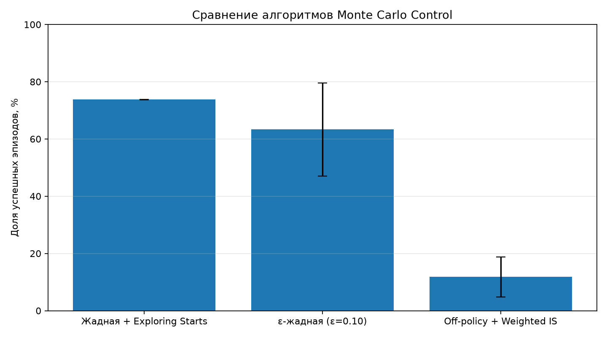
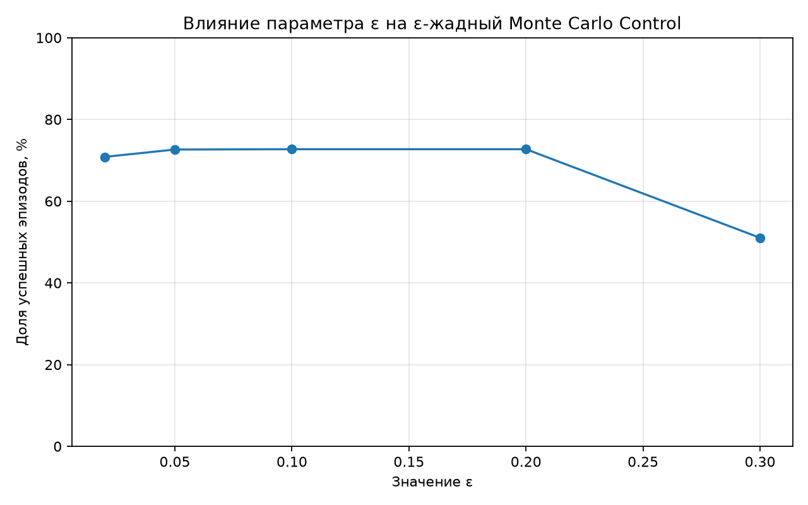
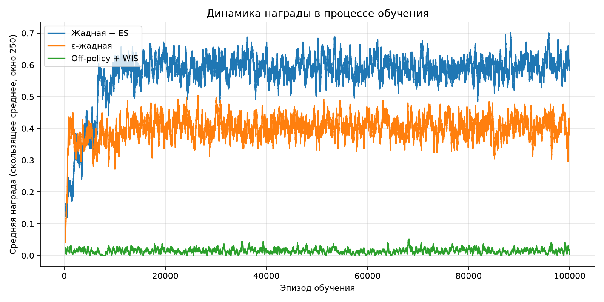

# Лабораторная работа № 3. Исследование метода Монте-Карло

## Цель работы

Реализовать и сравнить методы управления на основе метода Монте-Карло в среде FrozenLake: жадный с Exploring Starts, ε-жадный и Off-policy с Weighted Importance Sampling. Исследовать влияние количества обучающих эпизодов и параметра ε на качество стратегии.

## Описание среды

FrozenLake — дискретная среда обучения с подкреплением, в которой агент должен добраться до целевой клетки, не попав в полынью. Используется карта 4 × 4:

```text
S F F F
F H F H
F F F H
H F F G
```

S — старт, F — безопасная клетка, H — полынья, G — цель.

Среда представляет собой марковский процесс принятия решений (MDP). Состояние определяется номером клетки (0–15), действия кодируются числами: LEFT — 0, DOWN — 1, RIGHT — 2, UP — 3. При достижении цели награда равна 1, в остальных случаях — 0. В скользящем режиме фактическое направление движения может отличаться от выбранного, поэтому задача состоит в поиске стратегии с высокой вероятностью достижения цели, а не просто кратчайшего пути.

## Теоретические основы

### Метод Монте-Карло

Метод Монте-Карло (MC) оценивает качество состояний и действий по результатам завершённых эпизодов, не требуя модели переходов среды. В отличие от TD-методов, оценки обновляются после окончания эпизода на основе фактически полученного возврата.

Эпизод состоит из последовательности состояний, действий и наград. Возврат начиная с шага $t$ вычисляется по формуле:

$$
G_t=\sum_{k=t+1}^{T}\gamma^{k-t-1}R_k,\qquad G_t=R_{t+1}+\gamma G_{t+1}.
$$

При $\gamma=1$ возврат в FrozenLake равен 1 для успешного эпизода и 0 для неуспешного.

Функция $V^\pi(s)$ определяет ожидаемый возврат из состояния $s$ при следовании политике $\pi$. Функция $Q^\pi(s,a)$ оценивает возврат после выполнения конкретного действия:

$$
V^\pi(s)=\mathbb E_\pi[G_t\mid S_t=s],\qquad Q^\pi(s,a)=\mathbb E_\pi[G_t\mid S_t=s,A_t=a].
$$

Оценки вычисляются усреднением наблюдаемых возвратов:

$$
Q(s,a)=\frac{1}{N(s,a)}\sum_{i=1}^{N(s,a)}G_i(s,a).
$$

First-Visit MC учитывает только первое посещение состояния (или пары состояние–действие) за эпизод, Every-Visit MC — все посещения. Оба варианта оценки состояний реализованы в работе.

MC Prediction оценивает заданную политику, а MC Control дополнительно улучшает её на основе Q-значений. При управлении необходимо сочетать исследование новых действий (exploration) и использование накопленных знаний (exploitation).

### Greedy Monte Carlo Control с Exploring Starts

Жадная политика выбирает действие с максимальным Q-значением:

$$
\pi(s)=\arg\max_a Q(s,a).
$$

Чтобы агент не ограничивался уже известными действиями, используется Exploring Starts: в начале каждого эпизода случайно выбираются нетерминальное состояние и первое действие. Остальные действия выбираются жадно. После завершения эпизода Q-таблица обновляется методом First-Visit MC. При равных максимальных оценках действие выбирается случайно среди лучших.

### ε-Greedy Monte Carlo Control

Агент начинает эпизод из клетки 0. На каждом шаге с вероятностью ε выбирается случайное действие, иначе — действие с максимальным Q. При единственном лучшем действии вероятности составляют:

$$
\pi(a\mid s)=\begin{cases}1-\varepsilon+\varepsilon/4,&a=a^*,\\\varepsilon/4,&a\ne a^*.\end{cases}
$$

При ε = 0,1 вероятность выбора лучшего действия составляет 92,5%. Обновление Q выполняется методом First-Visit MC. При итоговой оценке ε устанавливается равным нулю.

### Off-policy Monte Carlo Control с Weighted Importance Sampling

В отличие от предыдущих методов, здесь используются две политики: поведенческая $b$ собирает опыт, равномерно выбирая действия ($b(a\mid s)=0,25$), а целевая $\pi$ является детерминированной жадной политикой.

Для учёта различий между политиками применяется Importance Sampling. При оценке пары $(S_t,A_t)$ вес зависит от последующих действий:

$$
W=\prod_{k=t+1}^{T-1}\frac{\pi(A_k\mid S_k)}{b(A_k\mid S_k)}.
$$

Weighted Importance Sampling использует взвешенное среднее возвратов. При обратном обходе эпизода накопленный вес и Q обновляются по формулам:

$$
C(s,a)\leftarrow C(s,a)+W,
$$

$$
Q(s,a)\leftarrow Q(s,a)+\frac{W}{C(s,a)}(G-Q(s,a)).
$$

Начальный вес равен 1. После обновления Q, если действие не совпадает с текущей целевой политикой, обработка более ранних шагов прекращается. Иначе вес умножается на $1/0,25=4$. При большом различии политик веса могут сильно различаться, а полезные для целевой политики последовательности встречаться редко.

### Сравнение методов

| Характеристика | Greedy + Exploring Starts | ε-Greedy | Off-policy + WIS |
|---|---|---|---|
| Тип управления | On-policy | On-policy | Off-policy |
| Выбор действий | Жадный | ε-жадный | Случайный для поведения |
| Исследование | Случайный старт пары «состояние — действие» | Случайный выбор с вероятностью ε | Равномерная поведенческая стратегия |
| Целевая стратегия | Жадная | ε-жадная во время обучения | Жадная |
| Обновление оценок | First-Visit MC | First-Visit MC | Weighted Importance Sampling |
| Основная особенность | Исследование за счёт начальных условий | Баланс исследования и использования | Разделение поведенческой и целевой стратегий |

## Программная реализация

Программа написана на Python с использованием Gymnasium для взаимодействия со средой, NumPy для хранения Q-таблиц и обработки результатов. Для построения графиков используется Matplotlib.

Среда создаётся через `gymnasium.make`. Эпизод завершается при `terminated or truncated`. Для Exploring Starts начальное состояние задаётся программно, поскольку стандартный `reset()` возвращает агента в клетку 0.

В ходе эпизода сохраняются тройки `(state, action, reward)`. Возвраты вычисляются обратным проходом, а First-Visit обновление выполняется с учётом первого появления пары в прямом порядке. Основные операции можно представить следующим сокращённым фрагментом:

```python
G = 0.0
returns = []
for state, action, reward in reversed(episode):
    G = reward + gamma * G
    returns.append(G)

visited = set()
for (s, a, _), G in zip(episode, reversed(returns)):
    if (s, a) in visited:
        continue
    visited.add((s, a))
    returns_sum[s, a] += G
    visits_count[s, a] += 1
    q_values[s, a] = returns_sum[s, a] / visits_count[s, a]
```

Для Greedy + ES и ε-Greedy различается способ генерации эпизодов, но обновление Q одинаковое. Для Off-policy дополнительно используется таблица накопленных весов. Сокращённая схема обновления:

```python
G, W = 0.0, 1.0
for s, a, reward in reversed(episode):
    G = reward + gamma * G
    C[s, a] += W
    Q[s, a] += W / C[s, a] * (G - Q[s, a])
    if a != target_action(Q, s):
        break
    W /= 0.25
```

Приведённые фрагменты иллюстрируют алгоритмы, а не являются полным исходным кодом проекта. После обучения Q-таблица размером 16 × 4 используется для отдельной оценки жадной политики из стандартной стартовой клетки.

## Методика экспериментов

| Параметр | Значение |
|---|---:|
| Количество обучающих эпизодов | 100 000 |
| Количество оценочных эпизодов | 100 000 |
| Коэффициент дисконтирования | 1.0 |
| Максимальная длина эпизода | 100 шагов |
| Количество запусков | 3 |
| Начальные зерна | 42, 43, 44 |
| Параметр ε для ε-Greedy | 0.1 |

Среда: FrozenLake-v1, карта 4 × 4, `is_slippery=True`. Основной эксперимент проводится для трёх seed; результаты представлены средним и стандартным отклонением.

Метрики:

$$
SuccessRate=\frac{N_{success}}{N_{total}}\cdot100\%,\qquad AverageSteps=\frac{1}{N}\sum_{i=1}^{N}T_i.
$$

Среднее число шагов учитывает и успешные, и неуспешные эпизоды. Поэтому основной критерий — Success Rate.

Дополнительно исследуются объёмы обучения от 1000 до 100 000 эпизодов и значения ε от 0,02 до 0,3. Эти серии не усредняются по трём запускам. Для анализа обучения используется скользящее среднее награды.

## Результаты и анализ

### Сравнение алгоритмов

**Таблица 1 — Сравнение алгоритмов управления**

| Алгоритм | Success Rate, % | Average Steps |
|---|---:|---:|
| Greedy + Exploring Starts | 73,77 ± 0,07 | 44,46 ± 0,04 |
| ε-Greedy, ε = 0,1 | 63,31 ± 16,22 | 36,68 ± 7,96 |
| Off-policy + Weighted IS | 11,78 ± 6,97 | 15,74 ± 9,29 |

*Примечание: значения представлены в формате «среднее ± стандартное отклонение»*



Лучший результат показал Greedy + ES — 73,77% при небольшом разбросе между запусками. Exploring Starts позволяет получать опыт из разных состояний, в том числе расположенных рядом с целью, тогда как остальные методы начинают обучение из клетки 0.

У ε-Greedy успешность составила 63,31%, а стандартное отклонение — 16,22 п.п. Это указывает на чувствительность к случайным условиям обучения. Постоянное исследование влияет на накопленные Q-оценки; при тестировании случайное исследование отключено, поэтому разница в успешности не объясняется непосредственно случайными действиями на этапе оценки.

Off-policy показал 11,78%. Возможные причины — редкие успешные траектории случайной поведенческой политики, большой разброс весов и прекращение обратного обновления при несовпадении действий с целевой политикой. Высокие веса отдельных наблюдений могут существенно влиять на Q-оценки.

Меньшее число шагов у Off-policy (15,74) не является преимуществом: неудачные эпизоды могут завершаться раньше из-за попадания в полынью.

### Влияние количества обучающих эпизодов

В таблице для каждого метода приведены Success Rate (%) / Average Steps.

| Эпизоды | Greedy + ES | ε-Greedy | Off-policy + WIS |
|---:|---:|---:|---:|
| 1 000 | 16,22 / 29,10 | 70,82 / 40,13 | 0,00 / 9,47 |
| 3 000 | 25,22 / 31,23 | 70,82 / 40,13 | 5,20 / 9,29 |
| 5 000 | 28,89 / 31,50 | 70,82 / 40,13 | 9,04 / 10,10 |
| 10 000 | 73,81 / 44,44 | 70,82 / 40,13 | 8,67 / 10,31 |
| 100 000 | 73,81 / 44,44 | 72,72 / 41,25 | 8,27 / 9,24 |


У Greedy + ES наиболее заметный прирост наблюдается между 5000 и 10 000 эпизодов: с 28,89% до 73,81%. Дальнейшее увеличение объёма обучения не изменило результат данной серии. У Off-policy монотонного роста нет.

Совпадение метрик ε-Greedy при 1000–10 000 эпизодах требует дополнительной проверки параметров запуска и итоговых политик. Результаты серии являются предварительными и не позволяют сделать вывод об общей устойчивости алгоритма.

### Влияние параметра ε

| ε | Success Rate, % | Average Steps |
|---:|---:|---:|
| 0,02 | 70,84 | 40,31 |
| 0,05 | 72,63 | 41,54 |
| 0,10 | 72,72 | 41,25 |
| 0,20 | 72,72 | 41,25 |
| 0,30 | 51,03 | 30,60 |



Наибольшая наблюдаемая успешность — 72,72% при ε = 0,1 и 0,2. При ε = 0,3 она снижается до 51,03%. Вероятная причина — влияние чрезмерного исследования на формирование Q-оценок во время обучения. Полное совпадение метрик при ε = 0,1 и 0,2 требует дополнительной проверки; оптимальность этих значений не доказана.

### Динамика обучения



Скользящее среднее награды отражает долю успешных обучающих эпизодов в пределах окна. Для Greedy + ES оно учитывает случайные старты, для ε-Greedy — исследующие действия, для Off-policy — поведение равномерной случайной политики. Поэтому графики характеризуют сбор опыта, а качество итоговых стратегий сравнивается по отдельной оценке.

### Анализ Q-таблиц

Ниже приведены итоговые Q-таблицы первого запуска. Полные результаты всех запусков сохранены в `results/experiment_results.json`.

#### Greedy + Exploring Starts

| Состояние | LEFT | DOWN | RIGHT | UP |
|---:|---:|---:|---:|---:|
| 0 | 0.703 | 0.701 | 0.660 | 0.479 |
| 1 | 0.458 | 0.452 | 0.444 | 0.629 |
| 2 | 0.407 | 0.585 | 0.568 | 0.651 |
| 3 | 0.430 | 0.412 | 0.433 | 0.619 |
| 4 | 0.702 | 0.464 | 0.468 | 0.467 |
| 5 | 0.000 | 0.000 | 0.000 | 0.000 |
| 6 | 0.394 | 0.233 | 0.357 | 0.210 |
| 7 | 0.000 | 0.000 | 0.000 | 0.000 |
| 8 | 0.481 | 0.475 | 0.475 | 0.713 |
| 9 | 0.533 | 0.729 | 0.489 | 0.429 |
| 10 | 0.662 | 0.539 | 0.430 | 0.401 |
| 11 | 0.000 | 0.000 | 0.000 | 0.000 |
| 12 | 0.000 | 0.000 | 0.000 | 0.000 |
| 13 | 0.543 | 0.584 | 0.801 | 0.559 |
| 14 | 0.806 | 0.894 | 0.832 | 0.836 |
| 15 | 0.000 | 0.000 | 0.000 | 0.000 |

#### ε-Greedy

| Состояние | LEFT | DOWN | RIGHT | UP |
|---:|---:|---:|---:|---:|
| 0 | 0.402 | 0.364 | 0.363 | 0.362 |
| 1 | 0.218 | 0.184 | 0.188 | 0.338 |
| 2 | 0.281 | 0.244 | 0.233 | 0.257 |
| 3 | 0.140 | 0.135 | 0.085 | 0.247 |
| 4 | 0.417 | 0.270 | 0.274 | 0.256 |
| 5 | 0.000 | 0.000 | 0.000 | 0.000 |
| 6 | 0.264 | 0.181 | 0.229 | 0.076 |
| 7 | 0.000 | 0.000 | 0.000 | 0.000 |
| 8 | 0.276 | 0.312 | 0.300 | 0.456 |
| 9 | 0.350 | 0.529 | 0.368 | 0.309 |
| 10 | 0.524 | 0.435 | 0.338 | 0.259 |
| 11 | 0.000 | 0.000 | 0.000 | 0.000 |
| 12 | 0.000 | 0.000 | 0.000 | 0.000 |
| 13 | 0.376 | 0.475 | 0.650 | 0.420 |
| 14 | 0.648 | 0.811 | 0.769 | 0.701 |
| 15 | 0.000 | 0.000 | 0.000 | 0.000 |

#### Off-policy + Weighted IS

| Состояние | LEFT | DOWN | RIGHT | UP |
|---:|---:|---:|---:|---:|
| 0 | 1.000 | 1.000 | 1.000 | 1.000 |
| 1 | 0.000 | 0.998 | 0.345 | 1.000 |
| 2 | 0.988 | 0.880 | 0.997 | 0.038 |
| 3 | 0.000 | 0.000 | 0.000 | 0.000 |
| 4 | 0.987 | 0.999 | 0.999 | 0.000 |
| 5 | 0.000 | 0.000 | 0.000 | 0.000 |
| 6 | 0.843 | 0.074 | 0.056 | 0.250 |
| 7 | 0.000 | 0.000 | 0.000 | 0.000 |
| 8 | 0.000 | 0.829 | 0.033 | 0.999 |
| 9 | 0.089 | 0.540 | 0.650 | 0.071 |
| 10 | 0.375 | 0.805 | 0.266 | 0.123 |
| 11 | 0.000 | 0.000 | 0.000 | 0.000 |
| 12 | 0.000 | 0.000 | 0.000 | 0.000 |
| 13 | 0.081 | 0.508 | 0.745 | 0.259 |
| 14 | 0.468 | 0.806 | 0.933 | 0.761 |
| 15 | 0.000 | 0.000 | 0.000 | 0.000 |

У Greedy + ES и ε-Greedy в состоянии 13 предпочтительным является RIGHT, в состоянии 14 — DOWN. У Off-policy многие оценки близки к единице, однако это не подтверждает высокое качество политики: взвешенные наблюдения могут существенно влиять на оценки, а фактическая успешность при тестировании остаётся низкой.

## Заключение

В работе реализованы три алгоритма управления методом Монте-Карло и проведено сравнение их эффективности в среде FrozenLake. При 100 000 обучающих эпизодов лучший результат показал Greedy + Exploring Starts (73,77 ± 0,07%), далее следуют ε-Greedy (63,31 ± 16,22%) и Off-policy + WIS (11,78 ± 6,97%).

Эксперименты показали, что качество стратегии зависит не только от количества эпизодов, но и от механизма исследования и обновления оценок. Для выбранной конфигурации наиболее эффективным оказался Exploring Starts. При этом сравнение ограничено одной картой, тремя основными запусками и предварительными дополнительными сериями. Полученные результаты не доказывают универсального превосходства метода или достижения теоретического оптимума.
